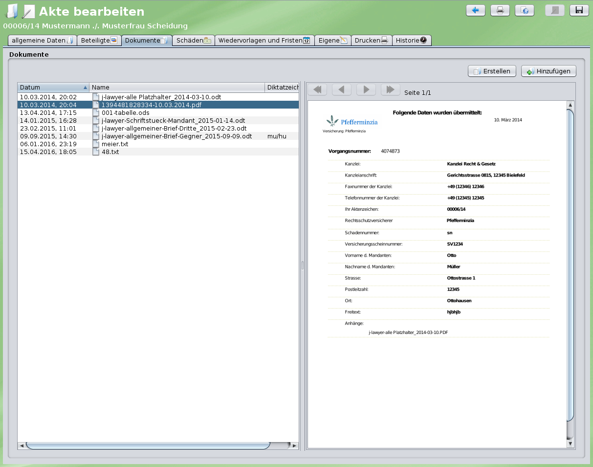

# Dokumente {#dokumente}

Der Tab "Dokumente" zeigt alle Dateien, die zur Akte gehören. Neben dem Dateinamen kann jedes Dokument fachliche [Metadaten](#metadaten) tragen – eine Bezeichnung, Schlagworte, ein Eingangsdatum und einen Absender bzw. Empfänger. Dokumente lassen sich außerdem als [Anlagen](#anlagen) einem anderen Dokument zuordnen, bspw. die Anhänge einer E-Mail.

## Ansichten {#ansichten}

Die Dokumente einer Akte können in zwei Ansichten dargestellt werden. Umgeschaltet wird über die beiden Schaltflächen **Liste mit Vorschau** und **Tabelle** in der Werkzeugleiste oberhalb der Dokumente.

| Ansicht | Geeignet für |
|---------|--------------|
| **Liste mit Vorschau** | Sichten und Lesen: zweizeilige Einträge, rechts daneben Vorschau, Details und Nachrichten des ausgewählten Dokuments |
| **Tabelle** | Überblick, Vergleichen und Sortieren vieler Dokumente: eine Zeile je Dokument mit konfigurierbaren Spalten |

Die gewählte Ansicht wird pro Nutzer gespeichert und gilt an jedem Arbeitsplatz. Beim Umschalten bleiben Ordnerauswahl, ausgewählte Dokumente, Sortierung und Filter erhalten.

### Liste mit Vorschau {#listenansicht}

Jedes Dokument wird in zwei Zeilen dargestellt:

- **Erste Zeile**: die Bezeichnung des Dokuments – ist keine Bezeichnung vergeben, der Dateiname
- **Zweite Zeile** (grau): ggf. „Anlage zu …", Von/An, Eingangsdatum („Eing. TT.MM.JJ"), der Dateiname (sofern eine Bezeichnung vergeben ist) sowie die Etiketten (grün) und Schlagworte (blau) als kleine Kacheln. Listenetiketten erscheinen als „Name: Wert".

Weitere Symbole am Eintrag:

- Ein **grünes Zahlensymbol** vor der Bezeichnung zeigt, wie viele [Anlagen](#anlagen) das Dokument hat. Ein Klick darauf oder auf den Pfeil klappt die Anlagen ein bzw. aus.
- Ein **Nachrichtensymbol mit Anzahl** erscheint, sobald es [Nachrichten zu dem Dokument](#nachrichten) gibt. Ein Klick darauf öffnet den Reiter **Nachrichten**.

Rechts neben der Liste zeigt der [rechte Bereich](#vorschau) Vorschau, Details und Nachrichten des ausgewählten Dokuments.

### Tabelle {#tabellenansicht}

Die Tabellenansicht zeigt eine Zeile je Dokument. Der rechte Bereich mit Vorschau, Details und Nachrichten ist in dieser Ansicht ausgeblendet.

| Spalte | Inhalt | Standard |
|--------|--------|:--------:|
| Markierung 1 / Markierung 2 | [Farbmarkierungen](#farbmarkierungen) – ein Klick öffnet die Farbauswahl | sichtbar |
| ★ | Favoritendokument | sichtbar |
| Typ | Dateityp | sichtbar |
| Vorschau (Auge) | Ein Klick öffnet eine Vorschau des Dokuments in einem eigenen Fenster | sichtbar |
| Bezeichnung | Bezeichnung bzw. Dateiname, bei Dokumenten mit Anlagen mit Pfeil zum Auf- und Zuklappen | immer |
| Dateiname | Dateiname | ausgeblendet |
| Von / An | Absender (↘) bzw. Empfänger (↗) | sichtbar |
| Eingang | Eingangsdatum (Uhrzeit im Tooltip) | sichtbar |
| Geändert | Datum der letzten Änderung | sichtbar |
| Erstellt | Erstellungsdatum | ausgeblendet |
| Schlagworte | Schlagworte | sichtbar |
| Etiketten | Dokument-Etiketten | sichtbar |
| Ordner | Ordner innerhalb der Akte | sichtbar |
| Größe | Dateigröße | sichtbar |
| Diktatzeichen | Diktatzeichen | ausgeblendet |
| Beleg | verknüpfter Rechnungsbeleg | ausgeblendet |
| Status | Anzahl der Nachrichten und Anlagen, „€" bei verknüpftem Beleg. Ein Klick auf die Nachrichtenanzahl zeigt die Nachrichten zum Dokument und ermöglicht eine neue Nachricht | sichtbar |

**Spalten anpassen**: Ein Rechtsklick auf die Kopfzeile öffnet ein Menü, in dem Spalten ein- und ausgeblendet werden können (die Spalte „Bezeichnung" ist immer sichtbar). **Standard wiederherstellen** setzt Auswahl, Reihenfolge und Breite der Spalten zurück. Reihenfolge und Breite werden durch Ziehen der Spaltenköpfe geändert. Die Spaltenkonfiguration wird pro Nutzer gespeichert.

**Sortieren**: Ein Klick auf einen Spaltenkopf sortiert nach dieser Spalte, ein weiterer Klick kehrt die Reihenfolge um. Datumsspalten zeigen beim ersten Klick die neuesten Dokumente zuerst. Die Spalte „Status" sortiert nach der Anzahl der Nachrichten.

**Direkt bearbeiten**: Bezeichnung und Schlagworte können in der Tabelle direkt bearbeitet werden.

| Taste | Wirkung |
|-------|---------|
| **F2** | Bearbeitet die Schlagworte, wenn deren Zelle markiert ist, sonst die Bezeichnung. Die markierte Zelle ist blau umrandet. |
| **Enter** | Bestätigt eine laufende Bearbeitung – sonst wird das Dokument geöffnet |
| **Doppelklick** | Öffnet das Dokument |

## Rechter Bereich: Vorschau, Details, Nachrichten {#vorschau}

In der Ansicht **Liste mit Vorschau** zeigt der rechte Bereich drei Reiter zum ausgewählten Dokument:

| Reiter | Inhalt |
|--------|--------|
| **Vorschau** | Darstellung des Dokuments |
| **Details** | [Metadaten](#metadaten) und Etiketten des Dokuments, direkt bearbeitbar |
| **Nachrichten** | [Nachrichten zu diesem Dokument](#nachrichten) |

### Vorschau

Durch einen einfachen Klick auf das Dokument wird eine Vorschau angezeigt.

| Vorschautyp | Formate |
|-------------|---------|
| **Direkte Anzeige** (Inhalt und Layout) | GIF, JPG, PDF, PNG, TIF |
| **Textanzeige** (Inhalt als Textextrakt) | Alle Dokumente mit Textinformationen |
| **Keine Vorschau** | Alle weiteren Binärformate |

Ein **Doppelklick** öffnet das Dokument im entsprechenden Editor.



Bei PDF-Dokumenten bietet die Vorschau zusätzlich einen Reiter **Text** mit dem extrahierten Text des Dokuments – nützlich zum schnellen Kopieren in die Zwischenablage.

**Navigation in der Vorschau**:

- **Blättern**: Mit den Pfeiltasten (links/rechts) können Sie zwischen Seiten blättern
- **Zoomen**: Mit dem Mausrad oder den Zoom-Schaltflächen

## Dokument-Metadaten {#metadaten}

Jedes Dokument kann folgende Metadaten tragen:

| Feld | Bedeutung |
|------|-----------|
| **Bezeichnung** | Lesbarer Titel unabhängig vom Dateinamen, bspw. „Klageerwiderung vom 12.03.2026" für die Datei `MX-2610N_20260315_114921.pdf`. Ist keine Bezeichnung vergeben, wird der Dateiname angezeigt. |
| **Schlagworte** | Freie Stichworte, durch Komma getrennt. Doppelte Einträge werden beim Speichern entfernt. |
| **Eingang** | Eingangsdatum, optional mit Uhrzeit (`TT.MM.JJJJ` oder `TT.MM.JJJJ SS:MM`). Unabhängig vom Datum, an dem das Dokument zur Akte hinzugefügt wurde. |
| **Von / An** | Absender eines eingehenden bzw. Empfänger eines ausgehenden Dokuments – als Kontakt aus dem Adressbuch oder als freier Text |
| **Anlage zu** | Das übergeordnete Dokument, siehe [Anlagen](#anlagen) |

Die Bezeichnung ändert nicht den Dateinamen – dafür gibt es weiterhin **umbenennen** im [Kontextmenü](#kontextmenue).

### Metadaten bearbeiten

Metadaten können an mehreren Stellen bearbeitet werden:

- im Reiter **Details** des rechten Bereichs (ein Dokument) – Änderungen werden mit **Speichern** übernommen
- im **Eigenschaften-Dialog**, Kontextmenü → **Eigenschaften...** (ein oder mehrere Dokumente)
- direkt in der [Tabelle](#tabellenansicht) (Bezeichnung und Schlagworte)

**Schlagworte**: Beim Tippen werden Schlagworte vorgeschlagen, die in der Akte bereits verwendet werden.

**Von / An**: Über das Auswahlfeld wird die Richtung gewählt – **Von (Eingang)** oder **An (Ausgang)**. Daneben wird der Name eingetragen. Über das Kontaktsymbol kann ein Beteiligter der Akte gewählt oder per **Kontakt suchen...** ein Kontakt im Adressbuch gesucht werden; **Von / An entfernen** leert das Feld. Ein Kontakt aus dem Adressbuch wird blau dargestellt. Wird der Name danach von Hand geändert, gilt er als freier Text und die Verknüpfung zum Kontakt entfällt. In Liste und Tabelle kennzeichnet ↘ ein eingehendes und ↗ ein ausgehendes Dokument.

### Mehrere Dokumente gleichzeitig bearbeiten {#metadaten-mehrfach}

Sind mehrere Dokumente ausgewählt, öffnet **Eigenschaften...** eine Mehrfachbearbeitung. Geändert werden nur die angehakten Felder – dafür aber bei allen ausgewählten Dokumenten. Ein Feld wird automatisch angehakt, sobald es bearbeitet wird.

| Feld | Verhalten |
|------|-----------|
| **Bezeichnung** | Setzt bei allen Dokumenten dieselbe Bezeichnung. Bleibt das Feld leer, wird die Bezeichnung entfernt. |
| **Schlagworte** | Wahlweise **hinzufügen** (Standard), **entfernen** oder **ersetzen** |
| **Eingang** | Setzt bei allen Dokumenten dasselbe Eingangsdatum |
| **Von / An** | Setzt bei allen Dokumenten denselben Absender bzw. Empfänger |

!!! info "Hinweis"
    Die Felder sind in der Mehrfachbearbeitung zunächst leer – abweichende Werte der einzelnen Dokumente werden nicht angezeigt. Die Zuordnung als Anlage kann nur für einzelne Dokumente geändert werden.

### Vorschläge von Assistent Ingo {#metadaten-ki}

Neben den Feldern **Bezeichnung** und **Schlagworte** befindet sich ein KI-Button. Er bietet alle [eigenen Prompts](../ki-assistent/eigene-prompts.md) der Funktionen **chat** und **extract** an und lässt Assistent Ingo anhand des Dokumentinhalts eine Bezeichnung bzw. Schlagworte vorschlagen:

- **Schlagworte**: Die Vorschläge erscheinen im Dialog „Vorgeschlagene Schlagworte" zur Auswahl. Bereits vorhandene Schlagworte sind ausgegraut.
- **Bezeichnung**: Der Vorschlag erscheint in einem Dialog und kann vor der Übernahme angepasst werden.

Übernommene Vorschläge werden zunächst nur in das Feld eingetragen und erst mit **Speichern** übernommen. In der Mehrfachbearbeitung werden über **Vorschläge je Dokument...** nacheinander Vorschläge für jedes ausgewählte Dokument eingeholt.

!!! note "Voraussetzung: eigene Prompts"
    Für die Vorschläge wird ein [eigener Prompt](../ki-assistent/eigene-prompts.md) benötigt – j-lawyer.org bringt dafür keinen fertigen Prompt mit. Ist kein eigener Prompt der Funktionen **chat** oder **extract** konfiguriert, ist der KI-Button deaktiviert.

#### Prompts für Bezeichnung und Schlagworte einrichten {#metadaten-ki-prompts}

Der KI-Button bietet alle eigenen Prompts der Funktionen **chat** und **extract** an – unabhängig davon, ob gerade eine Bezeichnung oder Schlagworte vorgeschlagen werden sollen. Es empfiehlt sich daher, für beide Zwecke je einen eigenen Prompt anzulegen und diese bspw. im [Untermenü](../ki-assistent/eigene-prompts.md#untermenues) „Metadaten" zu gruppieren.

j-lawyer.org übergibt dem Prompt automatisch den Dateinamen, eine vorhandene Bezeichnung, vorhandene Schlagworte und den Anfang des Dokumenttexts (für Schlagworte ca. drei, für die Bezeichnung ca. eine DIN-A4-Seite). Ausgewertet wird die Antwort wie folgt:

- **Schlagworte**: Die Antwort wird an Kommas, Semikolons und Zeilenumbrüchen aufgeteilt. Aufzählungszeichen und Anführungszeichen werden entfernt, Einträge mit mehr als 60 Zeichen verworfen.
- **Bezeichnung**: Übernommen wird die erste nicht leere Zeile der Antwort.

Der Prompt sollte das Modell deshalb anweisen, ausschließlich das Ergebnis zu liefern – ohne Einleitung oder Erläuterung.

!!! tip "Modell ohne Thinking verwenden"
    Für diese Prompts sollte ein Modell **ohne Thinking** (ohne vorgeschaltete „Denkphase") gewählt werden, bspw. **j-lawyer.CLOUD: Ingo Granite4.1**. Die Aufgabe ist kurz und klar umrissen; Modelle mit Thinking antworten hier deutlich langsamer, ohne bessere Vorschläge zu liefern.

**Vorschlag für einen Prompt „Schlagworte vorschlagen"** (Funktion **chat**, Untermenü „Metadaten"):

```text
Du verschlagwortest Dokumente einer Anwaltskanzlei. Schlage für das folgende Dokument
3 bis 6 Schlagworte vor, die beschreiben, worum es inhaltlich geht – bspw. Dokumentart,
Rechtsgebiet, Verfahrensschritt oder Gegenstand (z. B. "Klageerwiderung", "Mietminderung",
"Fristverlängerung").

Regeln:
- Jedes Schlagwort besteht aus höchstens drei Wörtern.
- Keine Personennamen, Aktenzeichen, Datumsangaben oder Geldbeträge.
- Bereits vorhandene Schlagworte nicht wiederholen.
- Antworte ausschließlich mit den Schlagworten, durch Komma getrennt, ohne Einleitung
  und ohne Erläuterung.
```

**Vorschlag für einen Prompt „Bezeichnung vorschlagen"** (Funktion **chat**, Untermenü „Metadaten"):

```text
Formuliere für das folgende Dokument einer Anwaltskanzlei eine kurze, aussagekräftige
Bezeichnung, wie sie in einer Aktenübersicht stehen würde – bspw. "Klageerwiderung des
Beklagten vom 12.03.2026" oder "Rechnung Kfz-Gutachten Sachverständigenbüro Meier".

Regeln:
- Höchstens 80 Zeichen.
- Nenne die Dokumentart und, falls erkennbar, Absender und Datum des Dokuments.
- Antworte ausschließlich mit der Bezeichnung in einer einzigen Zeile, ohne
  Anführungszeichen, ohne Einleitung und ohne Erläuterung.
```

### Automatisch gesetzte Metadaten {#metadaten-automatisch}

Beim Speichern und Versenden setzt j-lawyer.org Metadaten automatisch:

| Vorgang | Gesetzte Metadaten |
|---------|--------------------|
| E-Mail oder beA-Nachricht zur Akte speichern | Bezeichnung = Betreff, Eingang = Empfangsdatum, Von = Absender. Anhänge erhalten Eingang und Von/An der Nachricht und werden als Anlagen der Nachricht abgelegt. Eine E-Mail von der eigenen Adresse gilt als ausgehend (An = Empfänger). |
| E-Mail oder beA-Nachricht versenden | Die gespeicherte Nachricht erhält den Empfänger als „An". Mitgesendete Dokumente der Akte erhalten den Empfänger als „An", sofern sie noch kein Von/An haben. |
| Fax oder E-POST versenden | Das versendete Dokument erhält den Empfänger als „An" |

Absender und Empfänger werden – soweit möglich – einem Kontakt zugeordnet: zuerst unter den Beteiligten der Akte, dann im Adressbuch, ansonsten als freier Text.

!!! info "Bestehende Dokumente"
    Dokumente, die vor Version 3.6 zur Akte gespeichert wurden, erhalten keine Metadaten nachträglich. Für sie wird weiterhin der Dateiname angezeigt.

### Metadaten beim Speichern in die Akte {#metadaten-speichern}

Werden E-Mails, beA-Nachrichten oder Dateien über den Dialog **Dateien zur Akte speichern** abgelegt, können die Metadaten bereits vor dem Speichern je Datei geprüft und ergänzt werden: Bezeichnung, Eingang, Schlagworte und Von/An – jeweils mit den [Vorschlägen von Assistent Ingo](#metadaten-ki). Bei Anhängen legt die Option **als Anlage zu „…" speichern** (standardmäßig aktiv) fest, ob sie der Nachricht als Anlage zugeordnet werden.

Für alle markierten Dateien gemeinsam stehen zusätzlich zur Verfügung:

- **Schlagworte für alle...** und **Von / An für alle...** – setzt einen Wert für alle zum Speichern markierten Dateien
- **Schlagworte eintragen** und **Bezeichnungen vorschlagen** – führt einen Prompt für jede markierte Datei aus und trägt die Vorschläge direkt ein

!!! note "Größengrenze für KI-Vorschläge vor dem Speichern"
    Für Dateien, deren Text vor dem Speichern nicht lokal gelesen werden kann (alles außer PDF, TXT und HTML), gilt eine Größengrenze. Sie ist unter **Einstellungen** → **Assistent Ingo** → **Ingo-Server** im Feld „KI-Vorschläge vor dem Speichern bis max. Dateigröße (MB)" einstellbar (Standard: 3 MB, nur für Administratoren). Für größere Dateien oder Dokumente ohne erkennbaren Text (bspw. gescannte PDFs) sind Vorschläge nach dem Speichern im Reiter **Details** möglich.

## Anlagen {#anlagen}

Dokumente können einem anderen Dokument derselben Akte als Anlage zugeordnet werden – bspw. die Anhänge einer E-Mail oder die Anlagen eines Schriftsatzes. Beim Speichern von E-Mails und beA-Nachrichten geschieht das [automatisch](#metadaten-automatisch).

- **Zuordnen**: Ein oder mehrere Dokumente per Drag & Drop auf das gewünschte übergeordnete Dokument ziehen. Das Zieldokument wird beim Ziehen markiert.
- **Ändern oder lösen**: Im Reiter **Details** im Feld **Anlage zu** ein anderes Dokument wählen oder **(keine - eigenständiges Dokument)**.
- **Anzeigen**: Dokumente mit Anlagen zeigen in der Liste ein grünes Zahlensymbol, in der Tabelle einen Pfeil; Anlagen lassen sich damit ein- und ausklappen. Ist das übergeordnete Dokument im gewählten Ordner nicht sichtbar, wird die Anlage mit dem Hinweis „Anlage zu …" angezeigt.

!!! info "Einschränkungen"
    Nur Dokumente derselben Akte können als Anlagen zugeordnet werden. Ein Dokument kann nicht Anlage einer seiner eigenen Anlagen werden.

Werden ein Dokument und seine Anlagen gemeinsam in eine andere Akte kopiert oder verschoben, bleibt die Zuordnung erhalten. Wird nur die Anlage oder nur das übergeordnete Dokument kopiert, verschoben oder gelöscht, werden die verbleibenden Anlagen zu eigenständigen Dokumenten.

## Nachrichten zu Dokumenten {#nachrichten}

[Sofortnachrichten](../messaging.md), die sich auf ein Dokument beziehen, werden direkt am Dokument angezeigt. Der Reiter **Nachrichten** im rechten Bereich listet sie auf – die neueste zuerst – und bietet ein Eingabefeld für eine neue Nachricht mit Bezug zu diesem Dokument. **Antworten** übernimmt eine Nachricht als Ausgangspunkt für die Antwort. In der Tabelle öffnet ein Klick auf die Nachrichtenanzahl in der Spalte „Status" eine entsprechende Übersicht.

## Dokumente hinzufügen

Dokumente können auf verschiedene Wegen zur Akte hinzugefügt werden:

- **Drag & Drop**: Dateien vom Desktop, aus dem Dateimanager oder E-Mails aus dem klassischen Outlook in die Dokumentenliste ziehen – oder ohne die Akte zu öffnen auf einen Akteneintrag auf dem [Desktop](../oberflaeche.md#drag-drop)
- **Aus Vorlage erstellen**: Über den "Erstellen"-Button ein Dokument aus einer Vorlage generieren
- **Scannen**: Über die Scanner-Integration
- **E-Mail-Anhänge**: Beim Speichern von E-Mails zur Akte

## Dokumentetiketten

Dokumente können – ähnlich wie Akten – mit Etiketten versehen werden. Dies ermöglicht eine zusätzliche Kategorisierung und Filterung. Gesetzte Etiketten werden in der Liste als grüne Kacheln am Dokument bzw. in der Tabelle in der Spalte „Etiketten" angezeigt.

Bearbeitet werden die Etiketten im Reiter **Details** des rechten Bereichs oder im Eigenschaften-Dialog (Kontextmenü → **Eigenschaften...**). Änderungen an Etiketten werden – anders als die übrigen Metadaten – sofort gespeichert.

### Etiketten für mehrere Dokumente setzen

Wählen Sie mehrere Dokumente aus und öffnen Sie über das Kontextmenü **Eigenschaften...**. Etiketten, die nur an einem Teil der Auswahl gesetzt sind, werden hervorgehoben (siehe [Etiketten an einem Dokument](../etiketten.md#etiketten-dokument)).

### Etiketten automatisch vergeben

Dokument-Etiketten können anhand des Dateinamens automatisch vergeben werden – etwa um eingehende Post vorzusortieren. Siehe [Etiketten-Automatik](../etiketten.md#etiketten-automatik).

Eine vollständige Beschreibung von Etiketten, Listenetiketten und ihrer Konfiguration finden Sie im Kapitel [Etiketten](../etiketten.md).

## Volltextsuche innerhalb der Akte

Über das Suchfeld oberhalb der Dokumentenliste kann innerhalb der Akte gesucht werden. Durchsucht werden Dateiname, Bezeichnung, Schlagworte und Von/An; die Dokumentenliste wird entsprechend gefiltert.

Neben dem Suchfeld befindet sich ein Toggle-Button (Lupen-Icon), mit dem zwischen zwei Suchmodi umgeschaltet werden kann:

| Modus | Icon | Beschreibung |
|-------|------|-------------|
| **Dateinamensuche** | Lupe durchgestrichen | Sucht in Dateiname und Metadaten (Standard) |
| **Volltextsuche** | Lupe | Durchsucht zusätzlich den Inhalt aller Dokumente der Akte |

Die gewählte Einstellung wird pro Nutzer gespeichert und bleibt beim nächsten Anmelden erhalten.

## Umfangreiche Akten organisieren {#organisation}

Bei Akten mit vielen Dokumenten bietet j-lawyer.org verschiedene Funktionen, um den Überblick zu behalten.

### Farbmarkierungen {#farbmarkierungen}

Dokumente können mit zwei verschiedenen Farben markiert werden, um wichtige Dokumente hervorzuheben:

- Per Rechtsklick → **farblich hervorheben** → **erste Farbe** oder **zweite Farbe**
- Die Farbmarkierungen erscheinen als farbige Balken in der Dokumentenliste
- Die Farben können in den Einstellungen angepasst werden

!!! tip "Verwendungsbeispiele"
    - **Erste Farbe**: Wichtige Schriftsätze oder Urteile
    - **Zweite Farbe**: Dokumente, die noch bearbeitet werden müssen

### Favoritendokumente {#favoriten}

Häufig benötigte Dokumente können als Favoriten markiert werden und sind so jederzeit über das Sternsymbol im Kopf der Akte zugreifbar:

- Per Rechtsklick → **Favoritendokument an/aus**
- Favoriten werden mit einem Stern-Symbol gekennzeichnet
- Die Dokumentenliste kann nach Favoriten sortiert werden, sodass diese immer oben erscheinen

### Ordner und Unterordner {#ordnerstruktur}

Dokumente können in einer Ordnerstruktur organisiert werden:

- **Ordner erstellen**: Über das Drei-Punkte-Menü eines Ordners → **Unterordner erstellen**
- **Ordner umbenennen**: Über das Drei-Punkte-Menü → **Ordner umbenennen**
- **Ordner löschen**: Über das Drei-Punkte-Menü → **Ordner löschen** (löscht auch alle enthaltenen Dokumente!)
- **Dokumente verschieben**: Über den Button "in Ordner verschieben" oberhalb der Dokumentenliste oder per Kontextmenü

#### Ordnervorlagen anwenden

Über das Zahnradsymbol oberhalb der Ordnerliste können vordefinierte Ordnervorlagen auf die Akte angewendet werden:

- Wählen Sie die gewünschte Vorlage aus der Liste
- Es werden nur fehlende Ordner hinzugefügt, vorhandene bleiben erhalten
- Mehrere Vorlagen können nacheinander kombiniert werden

Die Ordnervorlagen werden unter **Einstellungen** → **Akten** → **Dokumentordner** verwaltet.

#### Ordneransicht filtern

Durch Klick auf einen Ordner in der Ordnerliste werden nur die Dokumente dieses Ordners angezeigt. Mehrere Ordner können gleichzeitig ausgewählt werden, um deren Inhalte gemeinsam anzuzeigen.

Über das Drei-Punkte-Menü eines Ordners kann **nur diesen Ordner auswählen** genutzt werden, um schnell alle anderen Ordner abzuwählen.

### Sortiermöglichkeiten {#sortierung}

Die Dokumentenliste kann nach verschiedenen Kriterien sortiert werden. Die Sortierbuttons befinden sich oberhalb der Dokumentenliste:

| Sortierung | Beschreibung |
|------------|--------------|
| **Änderungsdatum** | Nach dem letzten Änderungsdatum des Dokuments |
| **Erstellungsdatum** | Nach dem Erstellungsdatum des Dokuments |
| **Name** | Alphabetisch nach Dateiname |
| **Favorit** | Favoriten zuerst oder zuletzt |
| **Größe** | Nach Dateigröße |
| **Ordner** | Alphabetisch nach Ordnername |
| **Dateityp** | Nach Dateiendung gruppiert |

Jeder Sortierbutton kann durch erneutes Klicken zwischen aufsteigender und absteigender Sortierung umgeschaltet werden. Die gewählte Sortierung wird gespeichert.

Nach Bezeichnung, Eingang, Von/An, Schlagworten, Etiketten, Diktatzeichen oder Nachrichten kann über die Spaltenköpfe der [Tabelle](#tabellenansicht) sortiert werden. Diese Sortierung bleibt beim Wechsel in die Listenansicht erhalten, auch wenn dort keine Sortierschaltfläche als aktiv angezeigt wird.

!!! tip "Kombinierte Sortierung"
    Standardmäßig ist die Sortierung nach Änderungsdatum (absteigend) aktiv, sodass die neuesten Dokumente oben erscheinen. Für eine bessere Übersicht bei vielen Dokumenten empfiehlt sich die Sortierung nach Ordner oder Dateityp.

## PDF-Stapelexport {#stapelexport}

Oberhalb der Dokumentenliste befindet sich ein Button für den PDF-Stapelexport. Mit dieser Funktion können mehrere Dokumente zu einem einzigen PDF-Dokument zusammengeführt werden.

### Vorgehensweise

1. **Dokumente auswählen**: Markieren Sie die gewünschten Dokumente in der Dokumentenliste
2. **Stapelexport starten**: Klicken Sie auf den Export-Button oberhalb der Dokumentenliste

### Schritt 1: PDF-Konvertierung

Im ersten Schritt werden alle ausgewählten Dokumente automatisch in das PDF-Format konvertiert. Der Fortschritt wird angezeigt. Dokumente, die nicht konvertiert werden können (z.B. unbekannte Formate), werden mit einem Warnsymbol gekennzeichnet.

### Schritt 2: Dokumente sortieren

In diesem Schritt können Sie:

- **Reihenfolge festlegen**: Ordnen Sie die Dokumente per Drag & Drop in der gewünschten Reihenfolge an
- **Übersicht nutzen**: Der Button "Übersicht" öffnet eine Kachelansicht für einfacheres Sortieren
- **Reihenfolge umkehren**: Der Button "Umkehren" kehrt die aktuelle Reihenfolge um
- **Inhaltsverzeichnis**: Option zum Hinzufügen eines automatisch generierten Inhaltsverzeichnisses mit Seitenangaben und Lesezeichen
- **Seitenzahlen**: Option zum Hinzufügen von Seitenzahlen im Format "Seite X / Y"

Die Gesamtzahl der Seiten und die Dateigröße werden angezeigt.

### Schritt 3: Zusammenführen und Speichern

Im letzten Schritt werden die Dokumente zusammengeführt:

- Eine **Vorschau** des fertigen PDFs wird angezeigt
- Das Ergebnis kann **lokal gespeichert** werden (Verzeichnisauswahl)
- Das Ergebnis kann **zur Akte gespeichert** werden

!!! tip "Metadaten im PDF"
    Das exportierte PDF enthält automatisch Metadaten wie Aktenzeichen, Kurzrubrum, Sachgebiet, Anwalt und Erstellungsdatum. Diese erscheinen auch auf der ersten Seite, wenn ein Inhaltsverzeichnis erstellt wird.

!!! info "Verschlüsselte PDFs"
    Verschlüsselte oder fehlerhafte PDFs können nicht zusammengeführt werden. Diese werden übersprungen und am Ende des Vorgangs aufgelistet.

## Kontextmenü {#kontextmenue}

Per Rechtsklick auf ein oder mehrere Dokumente öffnet sich das Kontextmenü mit zahlreichen Aktionen.

### Grundlegende Aktionen

| Aktion | Beschreibung |
|--------|--------------|
| **öffnen** | Öffnet das Dokument im Standardprogramm |
| **öffnen mit...** | Öffnet das Dokument mit einem wählbaren Programm |
| **umbenennen** | Ändert den Dateinamen des Dokuments |
| **Eigenschaften...** | Öffnet den Dialog zum Bearbeiten von [Metadaten](#metadaten) und Etiketten – für ein oder mehrere Dokumente |
| **Erstellungsdatum anpassen** | Ändert das Erstellungsdatum des Dokuments |
| **löschen** | Verschiebt das Dokument in den Papierkorb |

### Kopieren und Verschieben

| Aktion | Beschreibung |
|--------|--------------|
| **in Zwischenablage kopieren** | Kopiert die ausgewählten Dateien in die Zwischenablage |
| **lokal speichern** | Speichert die ausgewählten Dokumente auf dem lokalen Rechner |
| **duplizieren** | Erstellt eine Kopie des Dokuments in der gleichen Akte |
| **in andere Akte kopieren** | Kopiert das Dokument in eine andere Akte |
| **in andere Akte verschieben** | Verschiebt das Dokument in eine andere Akte |

Beim Kopieren und Verschieben in eine andere Akte werden Metadaten, Etiketten, Favoritenstatus und Farbmarkierungen übernommen.

### Organisation und Kennzeichnung

| Aktion | Beschreibung |
|--------|--------------|
| **farblich hervorheben** | Hebt das Dokument farblich hervor (zwei Farben verfügbar) |
| **Favoritendokument an/aus** | Markiert das Dokument als Favorit für schnellen Zugriff |
| **Nachricht senden** | Sendet eine interne Nachricht zu diesem Dokument an Kollegen |

### PDF und Konvertierung {#pdf-konvertierung}

Das Untermenü **PDF und Konvertierung** enthält Funktionen zur PDF-Bearbeitung:

| Aktion | Beschreibung |
|--------|--------------|
| **Texterkennung (OCR)** | Führt eine Texterkennung für die ausgewählten Dokumente durch |
| **als PDF zusammenführen** | Exportiert alle ausgewählten Dokumente in ein einziges PDF |
| **PDF aufteilen** | Teilt ein PDF anhand von Seitenzahlen auf |
| **als PDF lokal speichern** | Speichert das Dokument als PDF auf dem lokalen Rechner |
| **PDF Seiten umsortieren** | Ermöglicht das Umsortieren der Seiten innerhalb eines PDFs |
| **PDF verkleinern** | Reduziert die Dateigröße eines PDFs |
| **verschlüsseltes PDF exportieren** | Exportiert das Dokument als passwortgeschütztes PDF |
| **ablegen als ...** | Speichert das Dokument in einem anderen Format zur Akte |
| **PDF schwärzen** | Schwärzt vertrauliche Inhalte in einem PDF |
| **PDF stempeln** | Fügt einen Textstempel (z.B. „KOPIE") zum PDF hinzu – siehe [PDFs stempeln](../dokumentenmanagement/pdf.md#pdf-stempeln) |

!!! info "Hinweis"
    Weitere Details zu PDF-Funktionen finden Sie unter [PDF-Funktionen](../dokumentenmanagement/pdf.md).

### Versand per E-Mail

| Aktion | Beschreibung |
|--------|--------------|
| **senden** | Sendet das Dokument per E-Mail über den integrierten Mailclient |
| **als PDF senden** | Konvertiert das Dokument zu PDF und sendet es per E-Mail |
| **im externen Mailprogramm öffnen** | Öffnet eine neue E-Mail im externen Mailprogramm mit dem Dokument als Anhang |

### Versand per beA

| Aktion | Beschreibung |
|--------|--------------|
| **senden** | Sendet das Dokument über das besondere elektronische Anwaltspostfach (beA) |
| **als PDF senden** | Konvertiert das Dokument zu PDF und sendet es per beA |

!!! info "Hinweis"
    Weitere Details zur beA-Integration finden Sie unter [beA (Anwaltspostfach)](../addon-bea.md).

### Weitere Versandoptionen

| Aktion | Beschreibung |
|--------|--------------|
| **als Fax senden** | Sendet das Dokument als Fax (erfordert Sipgate-Integration) |
| **drucken (Standarddrucker)** bzw. **Drucken** | Druckt das Dokument direkt auf dem Standarddrucker. Sind [Druckerfavoriten](#druckerfavoriten) eingerichtet, erscheint stattdessen das Untermenü **Drucken** mit dem Standarddrucker und den Favoriten |
| **per E-POST versenden** | Sendet das Dokument als Hybridbrief über E-POST |
| **Freigabe senden** | Teilt das Dokument über Nextcloud mit externen Empfängern |

!!! info "Hinweis"
    Für E-POST siehe [Add-On: E-POST](../addon-epost.md), für Nextcloud siehe [Add-On: Nextcloud](../addon-nextcloud.md).

#### Druckerfavoriten {#druckerfavoriten}

Standardmäßig druckt der Direktdruck auf den Standarddrucker des Betriebssystems. Sollen Dokumente auch direkt auf andere Drucker gedruckt werden können – bspw. auf einen Faxdrucker oder einen PDF-Drucker –, werden diese als Druckerfavoriten hinterlegt:

1. **Einstellungen** → **Dokumente** → **Druckerfavoriten** öffnen
2. Die gewünschten Drucker in der Spalte **Favorit** anhaken
3. Optional einen **Anzeigenamen** vergeben (Drucker markieren, dann in der Spalte „Anzeigename" doppelt klicken)
4. Mit **Übernehmen** speichern

Sobald mindestens ein Favorit verfügbar ist, enthält das Kontextmenü der Dokumente das Untermenü **Drucken** mit dem **Standarddrucker** an erster Stelle und den Favoriten darunter.

!!! info "Hinweise"
    - Druckerfavoriten werden pro Arbeitsplatz gespeichert, da die verfügbaren Drucker je Rechner unterschiedlich sind.
    - Im Menü erscheinen nur Favoriten, die aktuell verfügbar sind. Nicht verfügbare Favoriten bleiben in den Einstellungen erhalten.
    - Ist ein gewählter Drucker beim Drucken nicht mehr erreichbar, erscheint eine Fehlermeldung – es wird nicht stattdessen auf dem Standarddrucker gedruckt.

### KI-Assistent

| Aktion | Beschreibung |
|--------|--------------|
| **Assistent Ingo** | Öffnet den KI-Assistenten zur Analyse des Dokuments |

!!! info "Hinweis"
    Weitere Details zum KI-Assistenten finden Sie unter [KI-Assistent](../ki-assistent/index.md).

### Vorlagen

| Aktion | Beschreibung |
|--------|--------------|
| **als Vorlage speichern** | Speichert das Dokument als Vorlage für die spätere Wiederverwendung |
| **als PDF zur Akte speichern** | Konvertiert das Dokument zu PDF und speichert es zusätzlich zur Akte |
