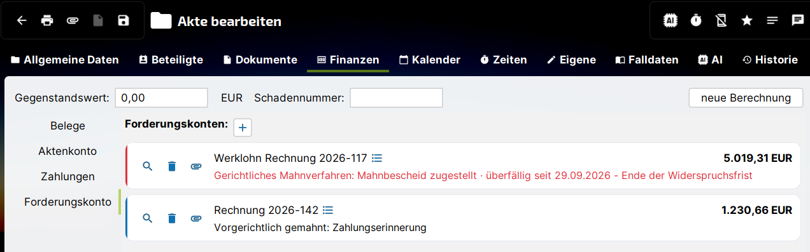

# Forderungskonto anlegen

Ein Forderungskonto gehört immer zu einer Akte. Es nimmt die Beteiligten der Forderung (Gläubiger und Schuldner), die einzelnen Forderungsbestandteile und alle Buchungen auf. Eine Akte kann mehrere Forderungskonten enthalten, bspw. wenn gegen verschiedene Schuldner unterschiedliche Forderungen bestehen.

## Neues Forderungskonto {#neu}

1. Akte öffnen und in den Reiter **Finanzen**, dort in den Bereich **Forderungskonto** wechseln.
2. Neben „Forderungskonten:“ auf den Button zum Hinzufügen klicken.
3. j-lawyer.org legt das Forderungskonto mit dem Namen „Forderungskonto in *Akte* (*Aktenzeichen*)“ an und öffnet es sofort.
4. Im Kopf des Dialogs **Name** und optional eine **Beschreibung** anpassen.
5. Im Reiter **Stammdaten** die Beteiligten erfassen (siehe unten), anschließend im Reiter **Positionen** die [Forderungen](forderungen.md) anlegen.
6. Mit **Speichern** übernehmen und schließen.

### Kopfbereich des Forderungskontos {#kopfbereich}

| Feld | Bedeutung |
|---|---|
| Name | Bezeichnung des Forderungskontos, wird auf der Karte in der Akte angezeigt |
| Beschreibung | Freitext, erscheint als Tooltip auf der Karte |
| Forderungen | Summe aller Forderungen und Kosten |
| Offen | Noch offener Betrag zum Stichtag |
| Stichtag | Datum, auf das Summen, Zinsen und Aufstellung berechnet werden (siehe [Salden & Aufstellung](aufstellung.md#stichtag)) |

Unter dem Kopfbereich zeigt die [Prozessleiste](index.md#prozess) die aktuelle Station der Forderung.

## Stammdaten: Gläubiger und Schuldner {#stammdaten}

Im Reiter **Stammdaten** werden die Beteiligten des Forderungskontos erfasst. Sie sind unabhängig von den Beteiligten der Akte, werden aber aus den Adressen gewählt. Gläubiger und Schuldner werden für das [gerichtliche Mahnverfahren](mahnverfahren.md) und die [Zwangsvollstreckung](zwangsvollstreckung.md) benötigt.

!!! warning "Ohne Beteiligte kein Mahnantrag"
    Ohne Gläubiger und Schuldner kann kein Mahnantrag erzeugt werden. Für reine Forderungsaufstellungen und das vorgerichtliche Mahnwesen sind die Stammdaten nicht zwingend erforderlich, aber empfehlenswert.

Die Tabelle der Beteiligten zeigt die Spalten **Rolle**, **Beteiligter**, **Verbraucher** und **Bezeichnung festgeschrieben**.

| Button | Funktion |
|---|---|
| Beteiligten hinzufügen | Öffnet den Dialog „Beteiligter des Forderungskontos“ |
| Bearbeiten | Ändert den markierten Beteiligten |
| Entfernen | Entfernt den markierten Beteiligten aus dem Forderungskonto |
| Aus Akte vorbelegen | Schlägt den Mandanten der Akte als Gläubiger und den Gegner als Schuldner vor |

**Aus Akte vorbelegen** ist nur für ein Forderungskonto ohne Beteiligte möglich. Es werden die Beteiligten der Akte in den Rollen *Mandant* und *Gegner* übernommen.

Unterhalb der Tabelle fasst ein Hinweis die Beteiligten zusammen, bspw. „1 Gläubiger, 2 Schuldner“. Mehrere Schuldner haften **gesamtschuldnerisch**, sofern eine Buchung nicht ausdrücklich einem einzelnen Schuldner zugewiesen wird.

### Dialog „Beteiligter des Forderungskontos“ {#beteiligter}

| Feld | Bedeutung |
|---|---|
| Rolle | *Gläubiger* oder *Schuldner* |
| Kontakt | Der Beteiligte aus den Adressen |
| Reihenfolge | Reihenfolge innerhalb der Rolle, bspw. für mehrere Antragsgegner im Mahnantrag |
| Verbraucher | Kennzeichnet den Beteiligten als Verbraucher. Für Verbraucher gilt: keine Pauschale nach § 288 Abs. 5 BGB, Verzugszinsen nach § 288 Abs. 1 BGB (5 Prozentpunkte über dem Basiszinssatz). |
| Prozessgericht | Nur für Schuldner: das Gericht, das bei Widerspruch das streitige Verfahren führt (§ 690 Abs. 1 Nr. 5 ZPO). Auswahl der Gerichtsart und des Gerichts aus den [Gerichtsstammdaten](einrichtung.md#gerichte) oder Eingabe von Postleitzahl und Ort. |
| Gesetzl. Vertreter | Nur auszufüllen, wenn die Partei nicht selbst handeln kann, bspw. eine GmbH (vertreten durch den Geschäftsführer). |

Als Gerichtsart für das Prozessgericht stehen zur Verfügung: Amtsgericht (Zivilabteilung), Landgericht (Zivilkammer), Landgericht – Kammer für Handelssachen, Amtsgericht – Familiengericht und Sozialgericht.

#### Gesetzliche Vertreter {#gesetzliche-vertreter}

Die gesetzlichen Vertreter bilden eine **Vertretungskette** von außen nach innen mit bis zu sechs Stufen. Beispiel: Eine GmbH & Co. KG wird vertreten durch die Komplementär-GmbH, diese durch ihren Geschäftsführer.

- Vertreter werden mit „Vertreter aus den Adressen hinzufügen“ ergänzt; der Vertreter muss zuvor in den Adressen angelegt sein.
- Mit den Pfeil-Buttons wird die Reihenfolge in der Kette geändert.
- In der Spalte **Stellung / Funktion** wird die Funktion des Vertreters gewählt (bspw. Geschäftsführer). Die Mahngerichte akzeptieren nur Funktionen aus ihrem Verzeichnis. Eine frei eingetragene Funktion kann gespeichert werden, j-lawyer.org weist aber darauf hin, dass das Mahngericht sie beanstanden kann.

### Festgeschriebene Bezeichnung {#festgeschrieben}

Die Spalte **Bezeichnung festgeschrieben** zeigt, ob Name und Anschrift eines Beteiligten für dieses Forderungskonto eingefroren sind. Eine festgeschriebene Bezeichnung bleibt unverändert erhalten, auch wenn der Kontakt in den Adressen später geändert wird, und der Kontakt kann im Dialog nicht mehr gegen einen anderen getauscht werden. So bleibt nachvollziehbar, unter welcher Bezeichnung ein Beteiligter gegenüber einem Gericht aufgetreten ist.

## Einstellungen zur Tilgung {#tilgungsreihenfolge}

Im unteren Bereich der Stammdaten wird festgelegt, wie Zahlungen auf die Forderung verrechnet werden.

| Einstellung | Bedeutung |
|---|---|
| Tilgungsreihenfolge | Reihenfolge, in der Zahlungen auf Kosten, Zinsen und Hauptforderung angerechnet werden (siehe unten) |
| Überschuss | Umgang mit Zahlungen, die eine Position übersteigen: „nach §§ 366, 367 BGB weiterverteilen“ oder „auf die nächste Position vortragen“ |
| Anzahl Gläubiger (Nr. 1008 VV RVG) | Anzahl der Auftraggeber, aus der sich die Erhöhung der Verfahrensgebühr ergibt |
| Verbraucherdarlehen (§ 497 Abs. 3 BGB) | Kennzeichnet die Forderung als Verbraucherdarlehen und stellt die Tilgungsreihenfolge entsprechend um |

| Tilgungsreihenfolge | Verrechnung |
|---|---|
| gesetzlich (§§ 366, 367 BGB) | Kosten, dann Zinsen, dann Hauptforderung (Standard) |
| Verbraucherdarlehen (§ 497 Abs. 3 BGB) | Kosten der Rechtsverfolgung, dann Hauptforderung, dann Verzugszinsen |
| gezielte Tilgung | Eine bestimmte Position wird vorrangig getilgt (§ 366 Abs. 1 BGB) |
| auf einen Schuldner | Die Zahlung wird nur auf Positionen eines einzelnen Schuldners verrechnet |
| manuell | Die Verteilung wird von Hand festgelegt |

Die gewählte Tilgungsreihenfolge wird bei der automatischen Verbuchung von Zahlungen angewendet, bspw. bei Zahlungen eines [Drittschuldners](zwangsvollstreckung.md#drittschuldner). Weicht sie von der gesetzlichen Reihenfolge ab, vermerkt j-lawyer.org dies in der Buchung. Wie Zahlungen im Reiter *Buchungen* verteilt werden, beschreibt [Buchungen & Zahlungen](buchungen.md#zahlungsverteilung).

## Forderungskonto löschen {#loeschen}

Ein Forderungskonto wird über den Löschen-Button auf seiner Karte in der Akte entfernt. Das Löschen kann nicht rückgängig gemacht werden. Dokumente, die aus dem Forderungskonto heraus erzeugt wurden (Mahnschreiben, Mahnanträge, Formulare), bleiben in der Akte erhalten.
