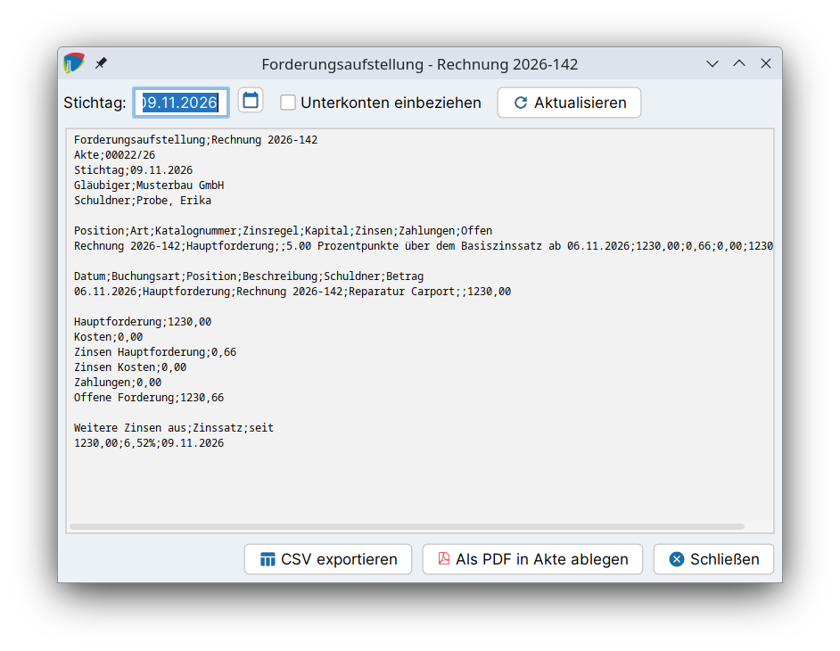

# Salden & Aufstellung

Das Forderungskonto berechnet aus Positionen, Zinsregeln und Buchungen jederzeit den aktuellen Forderungsstand. Er wird in den Reitern **Summen** und **Aufstellung** angezeigt und kann als Forderungsaufstellung in die Akte übernommen oder exportiert werden.

## Stichtag {#stichtag}

Alle Beträge werden auf einen **Stichtag** berechnet, der im Kopf des Forderungskontos gewählt wird. Standard ist das heutige Datum. Zinsen werden bis zum Stichtag dynamisch ausgewiesen.

Der Stichtag zählt immer **bis zum Ende des Tages**: Buchungen, die am Stichtag selbst erfasst sind, bspw. eine Zahlung an diesem Tag, sind in Summen und Aufstellung enthalten.

## Summen {#salden}

Der Reiter **Summen** zeigt den Forderungsstand zum Stichtag:

| Summe | Bedeutung |
|---|---|
| Hauptforderungen | Summe aller Hauptforderungen |
| Nebenforderungen | Summe aller Kosten und Nebenforderungen |
| Zinsen | Gebuchte und bis zum Stichtag aufgelaufene Zinsen auf Hauptforderungen und verzinsliche Kosten |
| bereits bezahlt | Summe aller Zahlungen |
| offen | Verbleibender Betrag nach Abzug der Zahlungen |

Für jede Position werden zudem ursprünglicher Betrag, aufgelaufene Zinsen, erhaltene Zahlungen, offener Forderungsbetrag, offene Zinsen und der Status (getilgt oder offen) berechnet.

Das Diagramm **Saldoverlauf** zeigt die Entwicklung des offenen Saldos über die Zeit.

Die Summe der Forderungen und der offene Betrag stehen außerdem im Kopf des Forderungskontos und auf seiner Karte in der Akte. Der Tooltip auf der Karte schlüsselt den offenen Betrag nach Hauptforderung, Kosten, Zinsen und Zahlungen auf.

## Aufstellung {#aufstellung}

Der Reiter **Aufstellung** listet alle Buchungen chronologisch in einer Kontoform auf, wie sie für eine Forderungsaufstellung üblich ist:

| Spalte | Inhalt |
|---|---|
| Datum | Datum der Buchung |
| Bezeichnung | Bezeichnung der Buchung |
| Zahlung | Zahlungen |
| unverz. Kosten | Unverzinsliche Kosten |
| verz. Kosten | Verzinsliche Kosten |
| Zinsen | Zinsen |
| Forderung | Forderungsbeträge |

Am Ende stehen zwei Summenzeilen:

- **Summe (ohne dyn. Zinsen):** die Summe der gebuchten Beträge
- **Summe (Stand *Datum*):** die Summe zum Stichtag einschließlich der bis dahin aufgelaufenen, noch nicht gebuchten Zinsen

## Forderungsaufstellung als PDF {#forderungsaufstellung}

Für Schreiben an Schuldner, Gerichte oder Mandanten wird eine Forderungsaufstellung als PDF erzeugt. Dazu auf der Karte des Forderungskontos in der Akte (*Finanzen → Forderungskonto*) auf den Button **Forderungsaufstellung** klicken (drittes Symbol links auf der Karte, Tooltip „Forderungsaufstellung“). Es öffnet sich ein eigener Dialog, unabhängig vom Reiter *Aufstellung* im Forderungskonto.

1. Im Dialog **Forderungsaufstellung** den **Stichtag** wählen und mit **Aktualisieren** neu berechnen. Der Dialog zeigt eine Vorschau der Aufstellung mit Beteiligten, Positionen, Buchungen, Summen und den weiter laufenden Zinsen.
2. Mit **Als PDF in Akte ablegen** wird die Aufstellung als PDF-Dokument in der Akte gespeichert.
3. Alternativ wird sie mit **CSV exportieren** als CSV-Datei gespeichert.

## Externe Verwendung der Aufstellung {#externe-verwendung}

Die Aufstellung kann im Reiter **Aufstellung** auch direkt für die Weiterverwendung außerhalb von j-lawyer.org exportiert werden. Dazu dienen die beiden Buttons rechts neben der Tabelle.

### In die Zwischenablage kopieren {#zwischenablage}

Über den Button mit dem Einfügen-Symbol wird die gesamte Aufstellung als formatierte HTML-Tabelle in die Zwischenablage übernommen. Die Tabelle kann direkt in Textverarbeitungen (bspw. LibreOffice Writer) oder Tabellenkalkulationen eingefügt werden. Schriftgröße und Rahmenfarbe richten sich nach den globalen Tabelleneinstellungen (Menü „Plugins“ – „Tabelleneinstellungen“).

### CSV-Export {#csv-export}

Über den Button mit dem Tabellenkalkulations-Symbol wird die Aufstellung als CSV-Datei (`aktenkonto-aufstellung.csv`) exportiert und direkt mit der dafür konfigurierten Anwendung geöffnet. Das eignet sich insbesondere für die Weiterverarbeitung in Tabellenkalkulationen.

!!! info "Hinweis"
    Es gibt keinen Platzhalter im Vorlagensystem, der die Aufstellung des Forderungskontos automatisch in Dokumente einfügt. Für Schreiben wird die Aufstellung daher als PDF in der Akte abgelegt oder über die Zwischenablage übernommen.
