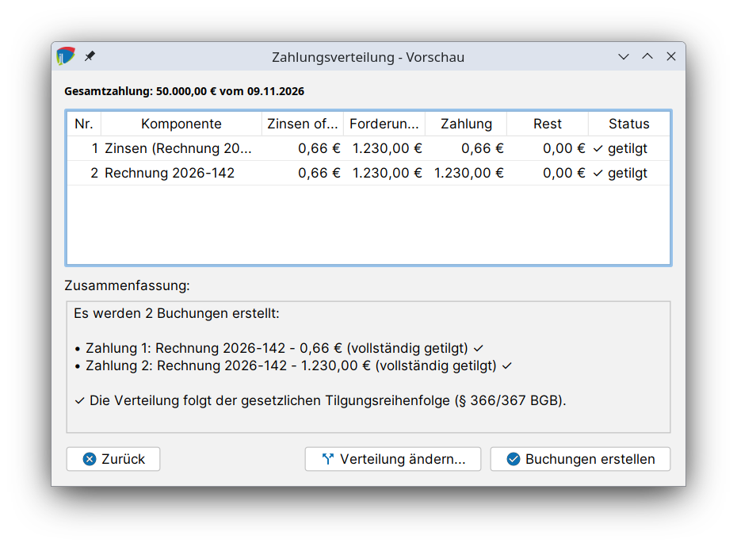

# Buchungen & Zahlungen

Alle Bewegungen eines Forderungskontos werden als **Buchungen** im Reiter **Buchungen** geführt: die Forderungsbeträge selbst, Kosten, Zinsen, Zahlungen und Korrekturen. Aus den Buchungen berechnet j-lawyer.org Salden, Zinsen und die [Forderungsaufstellung](aufstellung.md).

## Buchungsarten {#buchungsarten}

| Buchungsart | Beschreibung |
|---|---|
| Hauptforderung | Betrag einer Hauptforderung, wird beim Anlegen der Position automatisch gebucht |
| Kosten | Kosten und Nebenforderungen, bspw. Mahngebühren oder [Kosten der Zwangsvollstreckung](zwangsvollstreckung.md#kosten) |
| Zinsen | Zinsen auf eine Position bis zu einem Datum, werden automatisch berechnet |
| Zahlung | Zahlungen des Schuldners oder eines Drittschuldners |
| Korrekturbuchung | Korrekturen bestehender Buchungen |

Manche Buchungen erzeugt j-lawyer.org selbst, bspw. die Initialbuchung einer [Position](forderungen.md#positionen), die Mahngebühr beim [Versand einer Mahnung](mahnungen.md) oder die Kosten einer [Vollstreckungsmaßnahme](zwangsvollstreckung.md#kosten).

## Buchungen erfassen {#buchungen-erfassen}

Die Tabelle zeigt die Spalten **Datum**, **Typ**, **Betrag**, **Komponente** (die Position), **Schuldner**, **Bezeichnung** und **Kommentar**. In der Spalte *Schuldner* steht „alle“, wenn die Buchung alle Schuldner gesamtschuldnerisch betrifft.

Über die Buttons am Rand werden Buchungen hinzugefügt, bearbeitet und gelöscht. Der Dialog **Forderungskonto: Buchung** enthält folgende Felder:

| Feld | Bedeutung |
|---|---|
| Buchungsdatum | Datum der Buchung, bei Zahlungen der Tag des Zahlungseingangs |
| Buchungstyp | Eine der Buchungsarten (siehe oben) |
| Position | Die Position, auf die gebucht wird |
| Betrag | Betrag der Buchung |
| Bezeichnung | Kurzbeschreibung, erscheint in der Aufstellung |
| Kommentar | Optionaler, interner Kommentar |

Es gelten folgende Einschränkungen:

- Forderungs- und Kostenbuchungen können nicht gelöscht werden. Stattdessen wird die zugehörige Position im Reiter *Positionen* gelöscht.
- Zinsbuchungen können nicht bearbeitet werden, da sie automatisch berechnet sind. Eine falsche Zinsbuchung wird gelöscht und neu erfasst.

### Zinsen buchen {#zinsen-buchen}

Zinsen werden in Summen und Aufstellung bis zum Stichtag ohnehin dynamisch ausgewiesen. Eine Zinsbuchung hält sie zusätzlich dauerhaft fest, bspw. zum Abschluss eines Zeitraums.

1. Buchung hinzufügen, Buchungstyp **Zinsen** wählen.
2. Die verzinsliche **Position** wählen.
3. Als **Buchungsdatum** den Tag wählen, bis zu dem Zinsen gebucht werden sollen.
4. Speichern.

j-lawyer.org berechnet die Zinsen selbst und legt **je Zinszeitraum eine Buchung** an, bspw. bei einem Wechsel des Basiszinssatzes. Der Kommentar dokumentiert die Berechnung, bspw. „7,27% Zinsen aus 1000,00 EUR ab dem 01.01.2026 bis zum 30.06.2026 (180 Zinstage) aus Kaufpreis“.

### Buchungen exportieren {#export}

Mit **Exportieren** wird die Buchungsliste als CSV-Datei ausgegeben, mit **in Zwischenablage kopieren** als formatierte Tabelle.

## Zahlungsverteilung {#zahlungsverteilung}

Geht eine Zahlung ein, muss sie auf die offenen Positionen und deren Zinsen verteilt werden. j-lawyer.org schlägt die Verteilung vor, sie kann vor dem Buchen angepasst werden.

1. Buchung hinzufügen, Buchungstyp **Zahlung** wählen, Datum und Betrag eintragen.
2. Auf **Verteilung anzeigen...** klicken. Übersteigt die Zahlung den offenen Betrag, weist j-lawyer.org darauf hin.
3. Die **Zahlungsverteilung - Vorschau** zeigt für jede Position die offenen Zinsen, den offenen Forderungsbetrag, den darauf entfallenden Teil der Zahlung, den verbleibenden Rest und den Status („✓ getilgt“ oder „teilweise“).
4. Bei Bedarf mit **Verteilung ändern...** die Beträge von Hand anpassen (siehe unten).
5. Mit **Buchungen erstellen** übernehmen. Für jede Position wird eine eigene Zahlungsbuchung angelegt.

Die Vorschau verteilt die Zahlung nach der **gesetzlichen Tilgungsreihenfolge**:

1. Positionen in der Reihenfolge des § 366 Abs. 2 BGB: zuerst unverzinsliche Kosten, dann verzinsliche Kosten, zuletzt die Hauptforderung.
2. Innerhalb jeder Position werden nach § 367 BGB zuerst die Zinsen und dann der Forderungsbetrag getilgt.

### Verteilung manuell anpassen {#verteilung-anpassen}

Im Dialog **Zahlungsverteilung manuell anpassen** werden die Beträge je Position frei eingetragen. Oben werden **Verfügbar** (der Zahlungsbetrag), **Verteilt** und **Rest** angezeigt. Die Summe der verteilten Beträge muss genau dem Zahlungsbetrag entsprechen, erst dann kann die Verteilung mit **Übernehmen** gespeichert werden.

Eine abweichende Verteilung ist bspw. nötig, wenn der Schuldner bei der Zahlung bestimmt hat, welche Forderung er tilgen will (§ 366 Abs. 1 BGB).

### Automatische Verbuchung {#automatische-verbuchung}

Zahlungen, die j-lawyer.org selbst verbucht, bspw. die Zahlung eines [Drittschuldners](zwangsvollstreckung.md#drittschuldner), werden nach der in den [Stammdaten](anlegen.md#tilgungsreihenfolge) gewählten Tilgungsreihenfolge verteilt. Weicht diese von der gesetzlichen Reihenfolge ab, wird dies in den Buchungen vermerkt.
