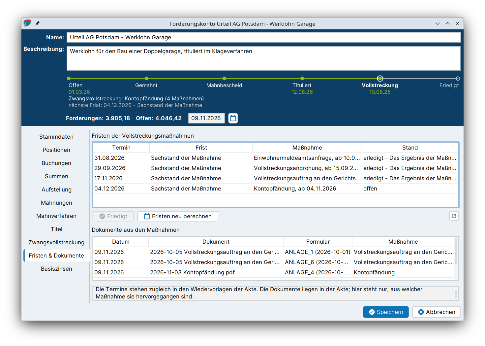

# Fristen & Wiedervorlagen

In allen Eskalationsstufen laufen Fristen: Zahlungsfristen der Mahnungen, Widerspruchs- und Einspruchsfristen im Mahnverfahren, die Verjährung von Titeln und die Fristen der Vollstreckungsmaßnahmen. j-lawyer.org berechnet diese Fristen selbst und trägt sie als **Wiedervorlagen** in der Akte ein. Sie erscheinen damit im [Kalender](../kalender/index.md) und in der Wiedervorlagenübersicht wie jede andere Wiedervorlage.

## Alle Fristen im Überblick {#uebersicht}

| Frist / Wiedervorlage | Stufe | Rechtsgrundlage | Berechnung |
|---|---|---|---|
| Zahlungsfrist *Stufe* läuft ab | [Mahnung](mahnungen.md) | | Versanddatum + Zahlungsfrist der Mahnstufe |
| Ende der Widerspruchsfrist | [Mahnverfahren](mahnverfahren.md#fristen) | § 692 Abs. 1 Nr. 3 ZPO | Zustellung des Mahnbescheids + 2 Wochen |
| Vollstreckungsbescheid beantragen | Mahnverfahren | § 699 Abs. 1 ZPO | Nächster Werktag nach Ende der Widerspruchsfrist |
| Mahnbescheid wird wirkungslos | Mahnverfahren | § 701 ZPO | Zustellung des Mahnbescheids + 6 Monate |
| Anspruchsbegründung bzw. Abgabe ans Streitgericht | Mahnverfahren | § 696 Abs. 1 ZPO | Widerspruch + 2 Wochen |
| Ende der Einspruchsfrist | Mahnverfahren | §§ 700 Abs. 1, 339 Abs. 1 ZPO | Zustellung des Vollstreckungsbescheids + 2 Wochen |
| Verjährung des Titels | [Titel](titel.md#verjaehrung) | § 197 Abs. 1 Nr. 3 BGB | Erlassdatum + 30 Jahre, abzüglich der gewählten Vorlaufzeit (Standard: 90 Tage) |
| Sachstand der Maßnahme | [Zwangsvollstreckung](zwangsvollstreckung.md#fristen) | | Absendedatum + Wiedervorlagefrist der Maßnahmeart |
| Drittschuldnererklärung | [Zwangsvollstreckung](zwangsvollstreckung.md#drittschuldner) | § 840 ZPO | Zustellung an den Drittschuldner + 2 Wochen |
| Erneute Vermögensauskunft möglich | Zwangsvollstreckung | § 802d Abs. 1 ZPO | Ergebnis der Vermögensauskunft + 2 Jahre |

## Wie Fristen berechnet werden {#berechnung}

- **Wochenenden und Feiertage:** Fällt das Ende einer gesetzlichen Frist auf einen Samstag, Sonntag oder allgemeinen Feiertag, verschiebt es sich auf den nächsten Werktag (§ 222 Abs. 2 ZPO). Die Wiedervorlage enthält dann einen Hinweis auf die Verschiebung.
- **Neuberechnung:** Ändert sich ein Datum, aus dem eine Frist folgt, bspw. das Zustellungsdatum des Mahnbescheids oder das Absendedatum einer Maßnahme, berechnet j-lawyer.org die Frist neu und verschiebt die Wiedervorlage.
- **Erledigte Wiedervorlagen:** Eine Wiedervorlage, die bereits als erledigt markiert ist, wird nicht mehr verändert. j-lawyer.org weist stattdessen darauf hin, dass sie geprüft werden sollte.
- **Entfallene Fristen:** Wird eine Frist durch einen späteren Stand gegenstandslos, bspw. die Widerspruchsfrist nach Eingang des Widerspruchs, wird die Wiedervorlage nicht gelöscht, sondern mit „Entfallen: …“ erledigt. So bleibt nachvollziehbar, welche Fristen liefen.
- **Zuständigkeit:** Die Wiedervorlagen werden dem Nutzer zugewiesen, der den auslösenden Schritt ausgeführt hat.

Die jeweils nächste Frist des Mahnverfahrens und der Vollstreckungsmaßnahmen (Sachstand, erneute Vermögensauskunft) erscheint in der [Prozessleiste](index.md#prozess) („nächste Frist: …“) und in der Statuszeile der [Karte in der Akte](index.md#akte). Ist sie versäumt, wird „überfällig seit …“ angezeigt und die Karte rot markiert.

## Reiter „Fristen & Dokumente“ {#reiter}

Der Reiter **Fristen & Dokumente** fasst die Fristen und Dokumente der [Vollstreckungsmaßnahmen](zwangsvollstreckung.md) zusammen. Die Fristen der Mahnungen, des Mahnverfahrens und der Drittschuldnererklärung werden in den jeweiligen Reitern bzw. beim Drittschuldner und in den Wiedervorlagen der Akte geführt.

### Fristen der Vollstreckungsmaßnahmen {#fristen-zv}

Die Tabelle zeigt **Termin**, **Frist**, **Maßnahme** und **Stand** („offen“, „überfällig“ oder „erledigt“ mit dem Grund, bspw. dass das Ergebnis der Maßnahme erfasst wurde). Die Termine stehen zugleich in den Wiedervorlagen der Akte.

| Button | Funktion |
|---|---|
| Erledigt | Erledigt die markierte Frist und die zugehörige Wiedervorlage. j-lawyer.org fragt nach dem Grund (Vorgabe: „Von Hand erledigt.“). |
| Fristen neu berechnen | Berechnet alle Fristen der Maßnahmen neu und gleicht die Wiedervorlagen ab, bspw. nach einer Korrektur von Daten |
| Neu laden | Aktualisiert die Anzeige |

### Dokumente aus den Maßnahmen {#dokumente}

Die untere Tabelle zeigt die Dokumente, die aus Vollstreckungsmaßnahmen erzeugt wurden, mit **Datum**, **Dokument**, **Maßnahme** und **Formular** (einschließlich der Formularfassung). Die Dokumente selbst liegen in der Akte; die Tabelle zeigt, zu welcher Maßnahme sie gehören.
