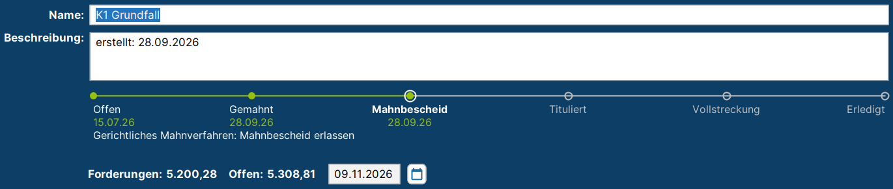
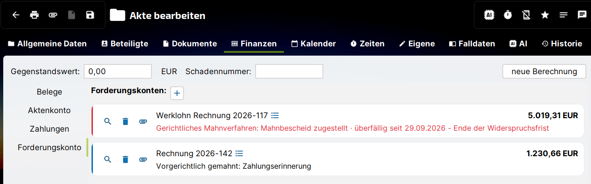

# Forderungskonto

Mit dem Forderungskonto werden Geldforderungen innerhalb einer Akte verwaltet und beigetrieben, von der ersten Zahlungserinnerung bis zur Zwangsvollstreckung. Es führt Haupt- und Nebenforderungen, Kosten, Zinsen und Zahlungen in einer gemeinsamen Buchhaltung zusammen und begleitet die Forderung durch alle Eskalationsstufen:

- **vorgerichtliches Mahnwesen** mit konfigurierbaren Mahnstufen, Mahngebühren und Verzugsbeginn
- **gerichtliches Mahnverfahren** mit Antrag auf Erlass eines Mahnbescheids im EDA-Format und Auswertung der Nachrichten des Mahngerichts
- **Titel** mit Prüfung der Vollstreckungsvoraussetzungen und Überwachung der Verjährung
- **Zwangsvollstreckung** mit den amtlichen Formularen der ZVFV, Vollstreckungskosten, Drittschuldnern und Ergebnissen

Fristen werden dabei automatisch berechnet und als Wiedervorlagen in der Akte angelegt.

## Der Prozess im Überblick {#prozess}

Eine Forderung durchläuft typischerweise die folgenden Stationen. Dieselben Stationen zeigt j-lawyer.org in der **Prozessleiste** im Kopf jedes Forderungskontos. Ein Klick auf eine Station führt zur ausführlichen Beschreibung.

1. [**Offen**Forderung fällig](forderungen.md)
2. [**Gemahnt**vorgerichtlich gemahnt](mahnungen.md)
3. [**Mahnbescheid**gerichtliches Mahnverfahren](mahnverfahren.md)
4. [**Tituliert**vollstreckbarer Titel](titel.md)
5. [**Vollstreckung**Zwangsvollstreckung](zwangsvollstreckung.md)
6. [**Erledigt**ausgeglichen](buchungen.md#zahlungsverteilung)

Nicht jede Forderung durchläuft alle Stationen. Zahlt der Schuldner nach der ersten Mahnung, ist die Forderung direkt erledigt. Liegt bereits ein Urteil vor, beginnt die Arbeit mit dem Erfassen des Titels.

| Station | Was passiert | Auslöser in j-lawyer.org | Was j-lawyer.org automatisch erledigt | Rechtsgrundlage |
|---|---|---|---|---|
| **Offen** | Die Forderung wird mit ihren Bestandteilen erfasst. | Reiter *Stammdaten* und *Positionen* | Initialbuchung je Position, Zinsberechnung nach den Zinsregeln | §§ 286, 288 BGB |
| **Gemahnt** | Der Schuldner wird außergerichtlich gemahnt, Stufe für Stufe. | Reiter *Mahnungen* → „Mahnung erzeugen“ | Mahnschreiben aus Vorlage, Buchung der Mahngebühr, Wiedervorlage zum Ablauf der Zahlungsfrist, ggf. Verzugsbeginn | § 286 BGB |
| **Mahnbescheid** | Beim zentralen Mahngericht wird ein Mahnbescheid beantragt. | Reiter *Mahnverfahren* → „Antrag erzeugen“, „Gerichtsnachricht einlesen“ | Prüfung des Antrags, EDA-Datei in der Akte, Statusführung, Fristen für Widerspruch, Vollstreckungsbescheid und § 701 ZPO als Wiedervorlagen | §§ 688 ff. ZPO |
| **Tituliert** | Ein vollstreckbarer Titel liegt vor, z. B. Vollstreckungsbescheid oder Urteil. | Reiter *Titel* → „Titel erfassen“ | Prüfung von Titel, Klausel und Zustellung, Wiedervorlage vor Ablauf der Verjährung | §§ 704, 724, 750 ZPO, § 197 BGB |
| **Vollstreckung** | Maßnahmen der Zwangsvollstreckung werden beantragt und verfolgt. | Reiter *Zwangsvollstreckung* → „Maßnahme“, „Formulare erzeugen“, „Kosten“, „Ergebnis“ | Ausgefüllte ZVFV-Formulare in der Akte, Kostenvorschlag nach § 788 ZPO, Wiedervorlagen zu Sachstand und Drittschuldnererklärung | §§ 802a ff., 828 ff. ZPO |
| **Erledigt** | Die Forderung ist vollständig bezahlt. | Reiter *Buchungen* → Zahlung buchen | Verteilung der Zahlung nach der Tilgungsreihenfolge | §§ 366, 367 BGB |

### Abweichungen vom Regelablauf {#abweichungen}

Verlässt eine Forderung den regulären Weg, zeigt die Prozessleiste unter den Stationen einen Hinweis an. Die aktuelle Station bleibt dabei erhalten.

| Hinweis | Bedeutung | Weitere Informationen |
|---|---|---|
| streitig: Widerspruch eingelegt – das Mahnverfahren wird nur auf Antrag fortgeführt (§ 696 Abs. 1 ZPO) | Der Schuldner hat dem Mahnbescheid widersprochen. | [Mahnverfahren](mahnverfahren.md) |
| streitig: Einspruch gegen den Vollstreckungsbescheid | Der Schuldner hat gegen den Vollstreckungsbescheid Einspruch eingelegt. | [Mahnverfahren](mahnverfahren.md) |
| an das Streitgericht abgegeben | Das Mahngericht hat die Sache an das Prozessgericht abgegeben. | [Mahnverfahren](mahnverfahren.md) |
| Mahnverfahren zurückgenommen | Der Antrag auf Erlass des Mahnbescheids wurde zurückgenommen. | [Mahnverfahren](mahnverfahren.md) |
| ruht: eine Maßnahme ist einstweilen eingestellt | Eine Vollstreckungsmaßnahme wurde einstweilen eingestellt. | [Zwangsvollstreckung](zwangsvollstreckung.md) |
| wartet bis …: eine erneute Vermögensauskunft ist erst dann zu verlangen (§ 802d ZPO) | Der Schuldner hat die Vermögensauskunft abgegeben, die Sperrfrist von zwei Jahren läuft. | [Zwangsvollstreckung](zwangsvollstreckung.md) |

Unter jeder erreichten Station steht das Datum, an dem sie erreicht wurde, darunter eine Zusammenfassung des aktuellen Stands. Eine Station gilt auch dann als erreicht, wenn eine spätere Station erreicht ist: Wird bspw. direkt ein Urteil als Titel erfasst, sind auch *Gemahnt* und *Mahnbescheid* markiert, dann ohne Datum.

In der letzten Zeile der Prozessleiste steht die **nächste Frist** („nächste Frist: Datum – Fristart“) oder, falls eine Frist versäumt wurde, „überfällig seit …“. Der Tooltip der Prozessleiste zeigt den bisherigen Verlauf mit allen Daten.

## Das Forderungskonto in der Akte {#akte}

Forderungskonten werden in der Akte im Reiter **Finanzen** unter **Forderungskonto** geführt. Eine Akte kann mehrere Forderungskonten enthalten, bspw. für verschiedene Schuldner oder Forderungen. Jedes Forderungskonto erscheint dort als Karte mit

- dem Namen (die Beschreibung erscheint als Tooltip),
- dem **offenen Betrag** (der Tooltip schlüsselt ihn nach Hauptforderung, Kosten, Zinsen und Zahlungen auf),
- einer **Statuszeile** mit der aktuellen Station, ggf. der Abweichung vom Regelablauf, unvollständigen Titeln, der Verjährung und der nächsten Frist.

Ist eine Frist überfällig oder hat die Forderung den Regelablauf verlassen, wird die Statuszeile rot dargestellt und die Karte rot markiert. So sind Forderungen, die Aufmerksamkeit benötigen, auf einen Blick erkennbar.

Die Symbole links auf der Karte öffnen das Forderungskonto (Lupe, „einsehen / bearbeiten“), löschen es (Papierkorb) oder erzeugen eine [Forderungsaufstellung](aufstellung.md#forderungsaufstellung). Wie ein neues Forderungskonto angelegt wird, beschreibt [Forderungskonto anlegen](anlegen.md).

## Aufbau des Forderungskontos {#aufbau}

Im Kopf des Forderungskontos stehen Name und Beschreibung, die Summe der Forderungen, der offene Betrag und der **Stichtag**, auf den alle Beträge und Zinsen berechnet werden. Darunter folgt die Prozessleiste. Die Arbeit selbst verteilt sich auf elf Reiter:

| Reiter | Inhalt | Beschreibung |
|---|---|---|
| Stammdaten | Gläubiger, Schuldner, gesetzliche Vertreter, Tilgungsreihenfolge | [Forderungskonto anlegen](anlegen.md) |
| Positionen | Haupt- und Nebenforderungen, Zinsregeln, Angaben für den Mahnbescheid | [Forderungen & Zinsen](forderungen.md) |
| Buchungen | Forderungen, Kosten, Zinsen, Zahlungen, Korrekturen | [Buchungen & Zahlungen](buchungen.md) |
| Summen | Salden und Saldoverlauf | [Salden & Aufstellung](aufstellung.md) |
| Aufstellung | Forderungsaufstellung zum Stichtag, Export | [Salden & Aufstellung](aufstellung.md) |
| Mahnungen | Vorgerichtliche Mahnstufen | [Vorgerichtliche Mahnung](mahnungen.md) |
| Mahnverfahren | Mahnsache, Antrag auf Mahnbescheid, Status, Gerichtsnachrichten | [Gerichtliches Mahnverfahren](mahnverfahren.md) |
| Titel | Vollstreckungstitel und ihre Voraussetzungen | [Titel](titel.md) |
| Zwangsvollstreckung | Maßnahmen, Formulare, Kosten, Drittschuldner, Ergebnisse | [Zwangsvollstreckung](zwangsvollstreckung.md) |
| Fristen & Dokumente | Fristen der Vollstreckungsmaßnahmen, erzeugte Dokumente | [Fristen & Wiedervorlagen](fristen.md) |
| Basiszinsen | Basiszinssätze und deren Aktualisierung | [Forderungen & Zinsen](forderungen.md#basiszins) |

## Vor dem ersten Einsatz {#einrichtung}

Für das Erfassen von Forderungen, Buchungen und Zinsen ist keine Einrichtung nötig. Für Mahnwesen, Mahnverfahren und Zwangsvollstreckung sollten einmalig folgende Einstellungen geprüft werden:

- **Mahnstufen** mit Zahlungsfristen, Mahngebühren und Vorlagen für die Mahnschreiben – [Einrichtung: Mahnstufen](einrichtung.md#mahnstufen)
- **Gerichte**, mindestens die Mahngerichte und die zuständigen Vollstreckungsgerichte – [Einrichtung: Gerichte](einrichtung.md#gerichte)
- **Mahngerichts-Zuordnung**, damit j-lawyer.org das zuständige Mahngericht ermitteln kann – [Einrichtung: Mahngerichts-Zuordnung](einrichtung.md#mahngerichts-zuordnung)
- **Kennziffer und EDA-Kürzel** der Anwältinnen und Anwälte für das Mahnverfahren – [Einrichtung: Nutzer](einrichtung.md#nutzer)
- **Vollstreckungsformulare** in der aktuell gültigen Fassung – [Einrichtung: Vollstreckungsformulare](einrichtung.md#vollstreckungsformulare)
