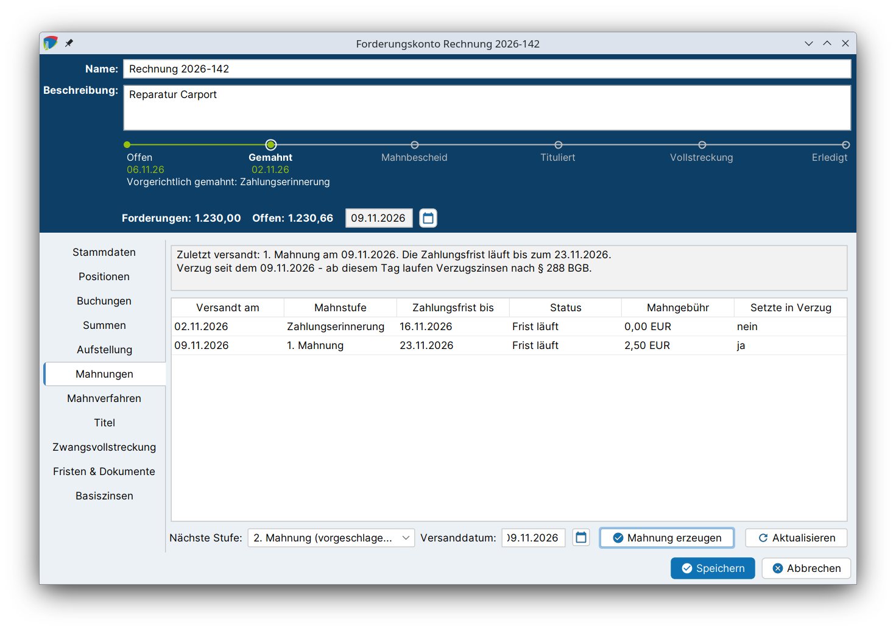

# Vorgerichtliche Mahnung

Bevor gerichtliche Schritte eingeleitet werden, wird der Schuldner in der Regel außergerichtlich gemahnt. Im Reiter **Mahnungen** des Forderungskontos werden die Mahnstufen nacheinander versandt. j-lawyer.org erzeugt dabei das Mahnschreiben, bucht die Mahngebühr, überwacht die Zahlungsfrist und hält fest, ab wann der Schuldner in Verzug ist.

!!! abstract "Auf einen Blick"
    - **Voraussetzungen:** Forderungskonto mit mindestens einer Position; [Mahnstufen](einrichtung.md#mahnstufen) sind eingerichtet (Standardstufen sind vorhanden).
    - **Ergebnis:** Mahnschreiben in der Akte, gebuchte Mahngebühr, Wiedervorlage zum Ablauf der Zahlungsfrist.
    - **Prozessleiste:** Station **Gemahnt**, sobald die erste Mahnung versandt ist.
    - **Nächster Schritt:** Zahlt der Schuldner nicht, folgt die nächste Mahnstufe. Nach der letzten Stufe bleibt das [gerichtliche Mahnverfahren](mahnverfahren.md).

## Mahnstufen {#mahnstufen}

Mahnstufen gelten kanzleiweit und werden unter *Einstellungen → Finanzen → Mahnstufen* gepflegt (siehe [Einrichtung](einrichtung.md#mahnstufen)). Jede Stufe legt fest

- die **Zahlungsfrist** in Tagen ab dem Versanddatum,
- die **Mahngebühr**, die beim Versand gebucht wird,
- ob die Stufe den Schuldner **in Verzug setzt** (§ 286 Abs. 1 BGB),
- die **Vorlage** für das Mahnschreiben.

Nach der Installation sind folgende Stufen vorhanden:

| Stufe | Zahlungsfrist | Mahngebühr | Setzt in Verzug |
|---|---|---|---|
| Zahlungserinnerung | 14 Tage | 0,00 € | nein |
| 1. Mahnung | 14 Tage | 2,50 € | ja |
| 2. Mahnung | 10 Tage | 2,50 € | nein |
| Letzte Mahnung vor gerichtlichen Schritten | 7 Tage | 2,50 € | nein |

!!! warning "Vorlagen hinterlegen"
    Den Standardstufen ist keine Vorlage zugeordnet. Ohne Vorlage wird beim Versand kein Schreiben erzeugt, die Stufe wird nur vermerkt. Vor dem ersten Einsatz sollte daher für jede Stufe eine Vorlage hinterlegt werden.

## Mahnung erzeugen {#mahnung-erzeugen}

1. Forderungskonto öffnen und in den Reiter **Mahnungen** wechseln.
2. Bei **Nächste Stufe** ist die nächste fällige Mahnstufe vorausgewählt und als „(vorgeschlagen)“ gekennzeichnet. Bei Bedarf kann eine andere Stufe gewählt werden.
3. Das **Versanddatum** prüfen (Standard: heute). Ab diesem Datum läuft die Zahlungsfrist.
4. Auf **Mahnung erzeugen** klicken.

j-lawyer.org erledigt dabei automatisch:

| Was | Details |
|---|---|
| Mahnschreiben | Ein Dokument aus der Vorlage der Stufe wird in der Akte abgelegt, benannt nach Stufe und Versanddatum. |
| Mahngebühr | Die Gebühr der Stufe wird als neue Position „Mahnkosten *Stufe*“ vom Typ *Mahnkosten* gebucht, mit dem Kommentar „Mahngebühr der Stufe … vom …“. Bei einer Gebühr von 0,00 € entfällt die Buchung. |
| Wiedervorlage | Zum Ablauf der Zahlungsfrist wird eine Wiedervorlage „Zahlungsfrist *Stufe* läuft ab am …“ in der Akte eingetragen. Sie erinnert daran, die nächste Mahnstufe zu veranlassen oder das gerichtliche Mahnverfahren einzuleiten. |
| Mahnstand | Die versandte Stufe wird mit Datum, Frist und Gebühr in der Tabelle festgehalten. |

Eine Meldung fasst zusammen, welches Schreiben abgelegt, welche Mahnkosten gebucht und zu welchem Datum die Wiedervorlage eingetragen wurde.

### Platzhalter im Mahnschreiben {#platzhalter}

Das Mahnschreiben wird wie jedes andere Dokument aus einer [Dokumentvorlage](../dokumentenmanagement/vorlagen.md) erzeugt. Als Beteiligte werden dabei die Beteiligten des Forderungskontos verwendet.

!!! tip "Beteiligte aus der Akte übernehmen"
    Rollenbezogene Platzhalter (bspw. für Mandant oder Gegner) werden nur gefüllt, wenn der Beteiligte des Forderungskontos aus einem Beteiligten der Akte stammt. Am einfachsten gelingt das mit **Aus Akte vorbelegen** in den [Stammdaten](anlegen.md#stammdaten).

## Welche Stufe ist die nächste? {#naechste-stufe}

j-lawyer.org wählt als nächste Stufe die **nächste aktive Stufe** nach der zuletzt versandten, in der unter *Einstellungen → Finanzen → Mahnstufen* festgelegten Reihenfolge. Inaktive Stufen werden übersprungen.

Sind alle Stufen versandt, zeigt der Reiter: „Alle konfigurierten Mahnstufen sind versandt. Weitergehend bleibt das gerichtliche Mahnverfahren.“

## Mahnstand und Verzug {#verzug}

Die Tabelle zeigt alle versandten Mahnungen mit den Spalten **Versandt am**, **Mahnstufe**, **Zahlungsfrist bis**, **Status** („Frist läuft“ oder „Frist abgelaufen“), **Mahngebühr** und **Setzte in Verzug**.

Darüber fasst ein Hinweis den Stand zusammen:

- „Für diese Forderung wurde noch nicht gemahnt.“
- „Zuletzt versandt: …“ mit dem Hinweis, bis wann die Zahlungsfrist läuft oder wann sie abgelaufen ist
- „Verzug ab …“, sobald eine Stufe versandt wurde, die in Verzug setzt

Der **Verzug** beginnt mit dem Versanddatum der ersten Stufe, die als „setzt den Schuldner in Verzug“ gekennzeichnet ist. Ab diesem Tag laufen Verzugszinsen nach § 288 BGB. Spätere Mahnungen verschieben den Verzugsbeginn nicht, denn eine zweite Mahnung beginnt den Verzug nicht neu.

!!! info "Verzug ohne Mahnung und Verzugszinsen"
    Verzug kann auch ohne Mahnung eingetreten sein, bspw. bei kalendermäßig bestimmter Leistungszeit oder 30 Tage nach Zugang einer Rechnung (§ 286 Abs. 2, 3 BGB). j-lawyer.org zeigt den Verzugsbeginn aus den Mahnungen an. Die Verzugszinsen selbst werden über die [Zinsregeln](forderungen.md#zinsregeln) der Positionen festgelegt.

## Hinweise {#hinweise}

- **Aktualisieren** lädt den Mahnstand neu, bspw. nachdem in einem anderen Fenster gebucht wurde.
- Das Forderungskonto muss gespeichert sein, bevor eine Mahnung erzeugt werden kann.
- Wird eine Mahnstufe in den Einstellungen geändert oder entfernt, bleiben bereits versandte Mahnungen unverändert erhalten.
- Die Mahngebühr darf nur die tatsächlich entstandenen Kosten abdecken.
