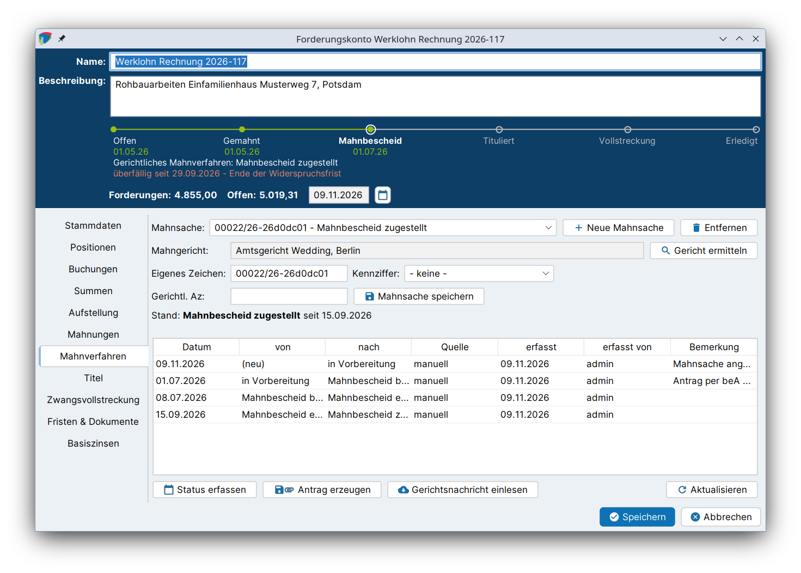

# Gerichtliches Mahnverfahren

Zahlt der Schuldner trotz Mahnung nicht, wird die Forderung im gerichtlichen Mahnverfahren (§§ 688 ff. ZPO) tituliert. j-lawyer.org bildet das Verfahren im Reiter **Mahnverfahren** als **Mahnsache** ab: vom Antrag auf Erlass eines Mahnbescheids über die Nachrichten des Mahngerichts bis zum Vollstreckungsbescheid. Der Antrag wird als **EDA-Datei** erzeugt, dem Datenaustauschformat der zentralen Mahngerichte, und über das beA eingereicht.

!!! abstract "Auf einen Blick"
    - **Voraussetzungen:**
        - Gläubiger mit Anschrift und Schuldner in den [Stammdaten](anlegen.md#stammdaten), beim Schuldner das Prozessgericht
        - Mindestens eine Hauptforderung mit den [Angaben für den Mahnbescheid](forderungen.md#angaben-mahnbescheid)
        - [Mahngerichts-Zuordnung](einrichtung.md#mahngerichts-zuordnung) sowie [Kennziffer und EDA-Kürzel](einrichtung.md#nutzer) des Anwalts
    - **Ergebnis:** Mahnbescheidsantrag als EDA-Datei in der Akte, Statusführung der Mahnsache, Fristen als Wiedervorlagen.
    - **Prozessleiste:** Station **Mahnbescheid**, sobald der Antrag gestellt ist.
    - **Nächster Schritt:** Den Vollstreckungsbescheid im Reiter *Titel* [als Titel erfassen](titel.md) (dann Station **Tituliert**) und die [Zwangsvollstreckung](zwangsvollstreckung.md) betreiben.

## Ablauf im Überblick {#ablauf}

1. [Mahnsache anlegen](#mahnsache-anlegen) und das zuständige Mahngericht ermitteln.
2. [Antrag erzeugen](#antrag-erzeugen): Angaben ergänzen, prüfen, EDA-Datei erzeugen.
3. Die EDA-Datei über das [beA](../addon-bea.md) an das Mahngericht senden.
4. Nachrichten des Mahngerichts [einlesen](#gerichtsnachricht) oder den [Status von Hand erfassen](#status-erfassen), bspw. Erlass und Zustellung des Mahnbescheids.
5. Nach Ablauf der Widerspruchsfrist den Vollstreckungsbescheid beantragen und den Stand erfassen.
6. Bei Widerspruch: Abgabe an das Streitgericht und Anspruchsbegründung.

## Mahnsache anlegen {#mahnsache-anlegen}

1. Forderungskonto öffnen und in den Reiter **Mahnverfahren** wechseln.
2. Auf **Neue Mahnsache** klicken. j-lawyer.org vergibt ein **eigenes Zeichen** aus dem Aktenzeichen und einer Kennung. Das Mahngericht wiederholt dieses Zeichen in all seinen Nachrichten, so werden die Nachrichten später der richtigen Mahnsache zugeordnet.
3. Auf **Gericht ermitteln** klicken. j-lawyer.org bestimmt das zuständige Mahngericht anhand der Anschrift des Gläubigers, denn das zuständige Mahngericht richtet sich nach dem allgemeinen Gerichtsstand des Antragstellers (§ 689 Abs. 2 ZPO). Kommen mehrere Gerichte in Betracht, wird das zuständige im Dialog **Mahngericht wählen** ausgewählt. Antragsteller ohne Gerichtsstand in Deutschland werden gesondert behandelt.
4. Die **Kennziffer** wählen. Zur Auswahl stehen die Anwältinnen und Anwälte, für die in der Nutzerverwaltung eine Kennziffer hinterlegt ist.
5. Mit **Mahnsache speichern** eigenes Zeichen, Kennziffer und gerichtliches Aktenzeichen dieser Mahnsache speichern.



| Feld / Button | Bedeutung |
|---|---|
| Mahnsache | Auswahl der Mahnsache, falls zu einem Forderungskonto mehrere bestehen |
| Neue Mahnsache / Entfernen | Mahnsache anlegen bzw. löschen |
| Mahngericht / Gericht ermitteln | Das zuständige Mahngericht, ermittelt aus der [Mahngerichts-Zuordnung](einrichtung.md#mahngerichts-zuordnung) |
| Eigenes Zeichen | Zeichen des Antragstellers, wird vom Gericht in jeder Nachricht wiederholt |
| Kennziffer | Kennziffer des Prozessbevollmächtigten beim Mahngericht |
| Gerichtl. Az | Aktenzeichen des Mahngerichts, wird aus Gerichtsnachrichten automatisch übernommen |
| Stand | Aktueller Status der Mahnsache und Datum |

!!! info "Speichern"
    **Mahnsache speichern** speichert nur die Angaben zur Mahnsache. Das Forderungskonto selbst wird wie gewohnt unten im Dialog gespeichert. Gibt es beim Schließen des Forderungskontos noch ungespeicherte Angaben zur Mahnsache, fragt j-lawyer.org nach.

Eine Mahnsache kann nur **gelöscht** werden, solange sie „in Vorbereitung“ ist und kein gerichtliches Aktenzeichen trägt. Dabei werden auch ihr Verlauf, ihre Fristen und die daraus entstandenen Wiedervorlagen gelöscht. Eine bereits beantragte Mahnsache wird stattdessen mit dem Status „zurückgenommen“ oder „abgeschlossen“ beendet.

## Antrag erzeugen {#antrag-erzeugen}

Mit **Antrag erzeugen** öffnet sich der Dialog **Mahnbescheidsantrag erzeugen**.

### Forderungen {#antrag-forderungen}

Die Tabelle zeigt die Positionen des Forderungskontos mit **Position**, **Art**, **Betrag**, **Rechnungsnr.**, **vom** und **Zinsen bis**. Die Positionen, die in den Antrag aufgenommen werden sollen, werden ausgewählt. Ein Antrag ohne Forderung ist nicht möglich.

Hauptforderungen werden mit ihrer Anspruchsart, vorgerichtliche Nebenforderungen in den jeweiligen Feldern des Antrags übertragen (siehe [Typen von Positionen](forderungen.md#positionstypen)).

### Angaben zum Antrag {#antrag-angaben}

| Feld | Bedeutung |
|---|---|
| Streitwert | Wert, nach dem sich die Gebühren richten |
| Anrechnung Nr. 2300/2302 VV RVG | Nur der auf die Verfahrensgebühr Nr. 3305 VV RVG anzurechnende Teil der vorgerichtlichen Geschäftsgebühr (Vorbem. 3 Abs. 4 VV RVG) |
| Beauftragung | Tag der Erteilung eines unbedingten Mandats, maßgeblich für die anzuwendende RVG-Fassung (§ 60 Abs. 1 S. 1 RVG) |
| besonderer Umfang / besondere Schwierigkeit wird versichert | Für eine Geschäftsgebühr über der Schwellengebühr |
| Gegenleistung | „Der Anspruch hängt nicht von einer Gegenleistung ab“ oder „Der Anspruch hängt von einer Gegenleistung ab, diese ist aber bereits erbracht“. Eine der beiden Erklärungen ist Pflicht (§ 688 Abs. 2 Nr. 2 ZPO), sonst wird der Antrag moniert. Bei mehreren Ansprüchen dürfen beide gesetzt sein. |
| Im Falle eines Widerspruchs wird die Durchführung des streitigen Verfahrens beantragt | Freiwillige Erklärung nach § 696 Abs. 1 ZPO. Die Sache wird nach einem Widerspruch dann ohne weiteren Antrag an das Streitgericht abgegeben. |
| Vergütung des Prozessbevollmächtigten | Welche Vergütung in den Mahnbescheid aufgenommen wird: die gesetzliche Vergütung nach dem RVG zzgl. Auslagen und Umsatzsteuer, eine vereinbarte Vergütung (Gesamtbetrag) oder keine Vergütung |
| EDA-ID | Kürzel des einreichenden Anwalts und eine fortlaufende Nummer; die Nummer wird beim Erzeugen der Datei vergeben |

### Antrag prüfen {#antrag-pruefen}

**Antrag prüfen** kontrolliert alle Angaben, bevor die Datei erzeugt wird, und meldet sämtliche Beanstandungen in einer Liste. **Fehler** verhindern das Erzeugen der Datei, **Hinweise** nicht. Geprüft werden unter anderem:

- Mahnsache, Mahngericht (mit Postleitzahl und Ort), Kennziffer und EDA-Kürzel
- Erklärung zur Gegenleistung und ggf. der Betrag einer vereinbarten Vergütung
- Gläubiger, Schuldner, Prozessgericht und die Funktionen gesetzlicher Vertreter
- Hauptforderung, Streitwert, Datum und Zeitraum des Anspruchs, Anspruchsart mit ihren Zusatzangaben und ggf. Vertragsart

Ist alles vollständig, meldet j-lawyer.org: „Der Antrag ist vollständig - es sind keine Beanstandungen offen.“

### EDA-Datei erzeugen {#eda-datei}

**EDA-Datei erzeugen** prüft den Antrag erneut und erzeugt nach einer Rückfrage die Datei. Dabei geschieht Folgendes:

- Die Datei wird als „Mahnbescheidsantrag….eda“ in der Akte abgelegt. Eine fehlerhafte Datei wird nie abgelegt.
- Die Mahnsache wechselt in den Stand **Mahnbescheid beantragt**.
- Die Mahnsache kann danach nicht mehr gelöscht werden.

!!! warning "Übermittlung per beA"
    j-lawyer.org versendet den Antrag nicht selbst. Die EDA-Datei wird aus der Akte heraus über das [beA](../addon-bea.md) an das Mahngericht übermittelt.

EDA-Dateien lassen sich in der Dokumentenvorschau lesbar anzeigen.

Beanstandet das Mahngericht den Antrag (Monierung), können die Angaben korrigiert und der Antrag erneut erzeugt werden, solange die Mahnsache „in Vorbereitung“ oder „Mahnbescheid beantragt“ ist. Er erhält dann eine neue EDA-ID.

## Nachrichten des Mahngerichts einlesen {#gerichtsnachricht}

Das Mahngericht antwortet mit EDA-Nachrichtendateien, bspw. über Erlass und Zustellung des Mahnbescheids. Diese Nachrichten werden eingelesen und auf die Mahnsachen übertragen:

1. Die Nachrichtendatei des Mahngerichts in der Akte ablegen (bspw. aus dem beA-Posteingang).
2. Im Reiter **Mahnverfahren** auf **Gerichtsnachricht einlesen** klicken.
3. Das Dokument wählen und auf **Datei analysieren** klicken.
4. Die Tabelle zeigt jede Nachricht mit **Pos.**, **Nachricht**, **Az (eigen)**, **Az (Gericht)**, **Zuordnung** und **Hinweis**.
5. Die vorgeschlagenen Zuordnungen prüfen, ggf. ändern oder mit „- nicht übernehmen -“ ausschließen.
6. Mit **Zuordnungen übernehmen** die Nachrichten auf die Mahnsachen anwenden.

Eine Nachrichtendatei kann mehrere Vorgänge betreffen; jede Position wird einzeln zugeordnet. Das Gericht nennt nicht die Akte, sondern wiederholt das mitgesandte eigene Zeichen. Der Vorschlag beruht darauf und wird deshalb nur vorgeschlagen, nicht automatisch gesetzt.

| Nachricht | Wirkung |
|---|---|
| Kosten / Erlass Mahnbescheid | Status „Mahnbescheid erlassen“ |
| Zustellung Mahnbescheid | Status „Mahnbescheid zugestellt“; Widerspruchsfrist und Frist nach § 701 ZPO beginnen |
| Kosten / Erlass Vollstreckungsbescheid | Status „Vollstreckungsbescheid erlassen“ |
| Zustellung Vollstreckungsbescheid | Status „Vollstreckungsbescheid zugestellt“; Einspruchsfrist beginnt |
| Widerspruch | Status „Widerspruch eingelegt“ |
| Abgabe | Status „an das Streitgericht abgegeben“ |
| Nichtzustellung | Nur Hinweis, keine Fristen |
| Monierung | Nur Hinweis; der Antrag muss korrigiert bzw. die Monierung beantwortet werden |
| Eingangsbestätigung | Betrifft nur die Übermittlung, nicht den Vorgang |

Übernommene Änderungen werden im Verlauf mit der Quelle „Gerichtsnachricht“ festgehalten, das gerichtliche Aktenzeichen wird übernommen. Eine ältere Nachricht setzt eine Mahnsache nie auf einen früheren Stand zurück. Nicht zugeordnete Nachrichten bleiben im Dokument und können später erneut eingelesen werden.

## Status von Hand erfassen {#status-erfassen}

Liegen Nachrichten des Gerichts nur auf Papier vor oder ist ein Schritt außerhalb von j-lawyer.org erfolgt, wird der Stand mit **Status erfassen** eingetragen:

| Feld | Bedeutung |
|---|---|
| Status | Der neue Stand der Mahnsache |
| Datum | Das Ereignisdatum; der Dialog erläutert für jeden Status, welches Datum gemeint ist, bspw. „Tag der Zustellung an den Antragsgegner“ |
| Bemerkung | Optionaler Freitext für den Verlauf |

Der Verlauf zeigt jeden Statuswechsel mit **Datum**, **von**, **nach**, **Quelle** („manuell“ oder „Gerichtsnachricht“), **erfasst**, **erfasst von** und **Bemerkung**.

!!! info "Antrag auf Vollstreckungsbescheid"
    Der Antrag auf Erlass des Vollstreckungsbescheids wird außerhalb von j-lawyer.org gestellt. Der Stand wird anschließend mit **Status erfassen** auf „Vollstreckungsbescheid beantragt“ gesetzt.

### Status einer Mahnsache {#status}

```
in Vorbereitung
  → Mahnbescheid beantragt → Mahnbescheid erlassen → Mahnbescheid zugestellt
      → Vollstreckungsbescheid beantragt → Vollstreckungsbescheid erlassen → Vollstreckungsbescheid zugestellt
      → Widerspruch eingelegt → an das Streitgericht abgegeben
                                  Einspruch eingelegt (gegen den Vollstreckungsbescheid)
Beenden jederzeit: zurückgenommen · abgeschlossen
```

| Status | Bedeutung für die Prozessleiste |
|---|---|
| in Vorbereitung | Noch kein Antrag gestellt, Station bleibt bei *Offen* bzw. *Gemahnt* |
| Mahnbescheid beantragt / erlassen / zugestellt | Station **Mahnbescheid** |
| Vollstreckungsbescheid beantragt / erlassen / zugestellt | Station **Mahnbescheid** |
| Widerspruch eingelegt, Einspruch eingelegt | Hinweis „streitig: …“ |
| an das Streitgericht abgegeben | Hinweis „an das Streitgericht abgegeben“ |
| zurückgenommen | Hinweis „Mahnverfahren zurückgenommen“ |

!!! tip "Vollstreckungsbescheid als Titel erfassen"
    Die Station **Tituliert** erreicht die Prozessleiste erst, wenn der Vollstreckungsbescheid im Reiter **Titel** erfasst ist, mit Erlassdatum, vollstreckbarer Ausfertigung und Zustellung. Erst dann sind auch Maßnahmen der [Zwangsvollstreckung](zwangsvollstreckung.md) möglich. Siehe [Titel](titel.md).

## Fristen {#fristen}

Bei jedem Statuswechsel berechnet j-lawyer.org die Fristen der Mahnsache neu und trägt sie als **Wiedervorlagen** in der Akte ein.

| Frist | Rechtsgrundlage | Berechnung |
|---|---|---|
| Ende der Widerspruchsfrist | § 692 Abs. 1 Nr. 3 ZPO | Zustellung des Mahnbescheids + 2 Wochen |
| Vollstreckungsbescheid beantragen | § 699 Abs. 1 ZPO | Nächster Werktag nach Ende der Widerspruchsfrist |
| Mahnbescheid wird wirkungslos | § 701 ZPO | Zustellung des Mahnbescheids + 6 Monate |
| Anspruchsbegründung bzw. Abgabe ans Streitgericht | § 696 Abs. 1 ZPO | Widerspruch + 2 Wochen |
| Ende der Einspruchsfrist | §§ 700 Abs. 1, 339 Abs. 1 ZPO | Zustellung des Vollstreckungsbescheids + 2 Wochen |

Fällt ein Fristende auf ein Wochenende oder einen Feiertag, verschiebt es sich auf den nächsten Werktag (§ 222 Abs. 2 ZPO). Fristen, die durch einen späteren Stand entfallen, werden nicht gelöscht, sondern mit „Entfallen: …“ erledigt. Einzelheiten beschreibt [Fristen & Wiedervorlagen](fristen.md).

## Hinweise {#hinweise}

- Das zuständige Mahngericht wird aus der Anschrift des **Gläubigers** ermittelt. Ohne Gläubiger mit Anschrift kann kein Gericht ermittelt werden.
- Die Funktionen gesetzlicher Vertreter müssen dem Verzeichnis der Mahngerichte entsprechen, sonst droht eine Monierung (siehe [Gesetzliche Vertreter](anlegen.md#gesetzliche-vertreter)).
- **Aktualisieren** lädt Mahnsachen und Verlauf neu.
