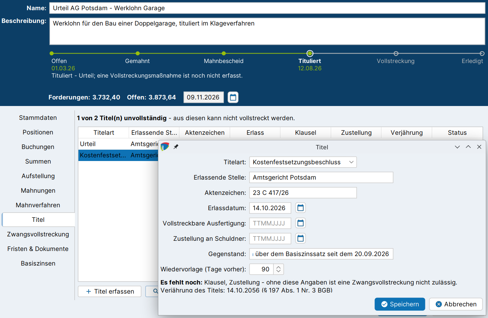

# Titel

Die Zwangsvollstreckung setzt einen **vollstreckbaren Titel** voraus, der mit der **Vollstreckungsklausel** versehen und dem Schuldner **zugestellt** ist (§§ 704, 724, 750 ZPO). Im Reiter **Titel** des Forderungskontos werden die Titel erfasst, die für die Forderung vorliegen. j-lawyer.org prüft, ob die Vollstreckungsvoraussetzungen vollständig sind, und überwacht die Verjährung des titulierten Anspruchs.

!!! abstract "Auf einen Blick"
    - **Voraussetzungen:** Ein Titel liegt vor, bspw. aus dem [gerichtlichen Mahnverfahren](mahnverfahren.md) (Vollstreckungsbescheid) oder aus einem Klageverfahren (Urteil).
    - **Ergebnis:** Titel mit Klausel und Zustellung im Forderungskonto, Wiedervorlage vor Ablauf der Verjährung.
    - **Prozessleiste:** Station **Tituliert**, sobald ein Titel erfasst ist.
    - **Nächster Schritt:** [Zwangsvollstreckung](zwangsvollstreckung.md).

## Titel erfassen {#titel-erfassen}

1. Forderungskonto öffnen und in den Reiter **Titel** wechseln.
2. Auf **Titel erfassen** klicken.
3. Die Angaben zum Titel eintragen (siehe unten) und **Speichern**.

| Feld | Bedeutung |
|---|---|
| Titelart | Art des Titels (siehe unten) |
| Erlassende Stelle | Gericht, Notar oder Behörde, die den Titel erlassen hat |
| Aktenzeichen | Aktenzeichen des Titels |
| Erlassdatum | Ausstellungsdatum des Titels, Grundlage für die Verjährung |
| Vollstreckbare Ausfertigung | Datum der Vollstreckungsklausel (§ 724 ZPO) |
| Zustellung an Schuldner | Datum der Zustellung des Titels an den Schuldner (§ 750 Abs. 1 ZPO) |
| Gegenstand | Was tituliert ist, als Freitext |
| Wiedervorlage (Tage vorher) | Wie viele Tage vor Ablauf der Verjährung die Wiedervorlage eingetragen wird (Standard: 90) |

Als **Titelarten** stehen zur Verfügung:

- Vollstreckungsbescheid
- Urteil
- Kostenfestsetzungsbeschluss
- Prozessvergleich
- notarielle Urkunde
- Anerkenntnis
- sonstiger Titel

## Vollstreckungsvoraussetzungen {#voraussetzungen}

Während der Eingabe zeigt der Dialog, ob alle Voraussetzungen erfüllt sind:

- „Vollstreckungsvoraussetzungen vollständig (Titel, Klausel, Zustellung).“
- „Es fehlt noch: … – ohne diese Angaben ist eine Zwangsvollstreckung nicht zulässig.“

Ein Titel kann auch unvollständig gespeichert werden, bspw. wenn die vollstreckbare Ausfertigung noch aussteht. Die fehlenden Angaben werden nachgetragen, sobald sie vorliegen.

Die Tabelle im Reiter zeigt alle Titel mit **Titelart**, **Erlassende Stelle**, **Aktenzeichen**, **Erlass**, **Klausel**, **Zustellung**, **Verjährung** und **Status**. Der Status lautet „vollstreckbar“ oder „es fehlt: …“. Ein Hinweis über der Tabelle fasst zusammen, ob die Titel vollständig sind:

- Ohne Titel: „Für dieses Forderungskonto ist kein Titel erfasst. … Ohne Titel, Klausel und Zustellung ist keine Zwangsvollstreckung möglich.“
- Bei unvollständigen Titeln: „… Titel unvollständig – aus diesen kann nicht vollstreckt werden.“

Unvollständige Titel erscheinen auch in der Statuszeile der [Karte in der Akte](index.md#akte) als „Titel unvollständig“.

!!! info "Auswirkung auf die Zwangsvollstreckung"
    Beim Anlegen einer [Vollstreckungsmaßnahme](zwangsvollstreckung.md#massnahme-anlegen) wird der Titel gewählt, aus dem vollstreckt wird. Fehlen Klausel oder Zustellung, bietet j-lawyer.org die Maßnahmen, die einen Titel erfordern, nicht an und nennt den Grund.

## Verjährung {#verjaehrung}

Rechtskräftig festgestellte Ansprüche und Ansprüche aus vollstreckbaren Titeln verjähren in **30 Jahren** (§ 197 Abs. 1 Nr. 3, 4 BGB). j-lawyer.org berechnet das Verjährungsdatum aus dem **Erlassdatum** und zeigt es im Dialog als „Verjährung des Titels: *Datum* (§ 197 Abs. 1 Nr. 3 BGB)“ an.

Beim Speichern wird eine **Wiedervorlage** zur Verjährung in der Akte eingetragen, die festgelegte Anzahl von Tagen vor dem Verjährungsdatum. Ändert sich das Erlassdatum, wird die Wiedervorlage angepasst. Wird der Titel entfernt, wird auch die Wiedervorlage zur Verjährung entfernt.

Das nächste Verjährungsdatum erscheint in der Statuszeile der Karte in der Akte („Verjährung *Datum*“).

!!! warning "Beginn der Verjährung prüfen"
    Die Verjährung beginnt rechtlich mit der Rechtskraft der Entscheidung bzw. der Errichtung des Titels (§ 201 BGB). j-lawyer.org rechnet vereinfachend ab dem Erlassdatum. Für künftig fällig werdende, regelmäßig wiederkehrende Leistungen gilt die regelmäßige Verjährungsfrist (§ 197 Abs. 2 BGB). In solchen Fällen sollte die Wiedervorlage geprüft und ggf. angepasst werden.

## Titel bearbeiten und entfernen {#bearbeiten}

- **Bearbeiten** öffnet den markierten Titel, bspw. um das Datum der Zustellung nachzutragen.
- **Entfernen** löscht den markierten Titel nach einer Rückfrage. Die Wiedervorlage zur Verjährung wird mit entfernt.
