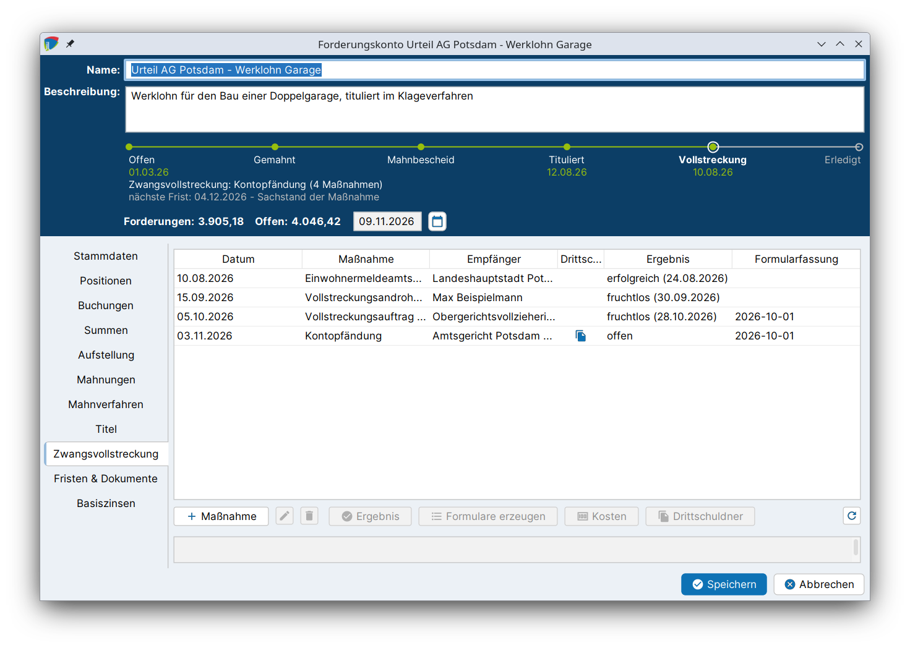
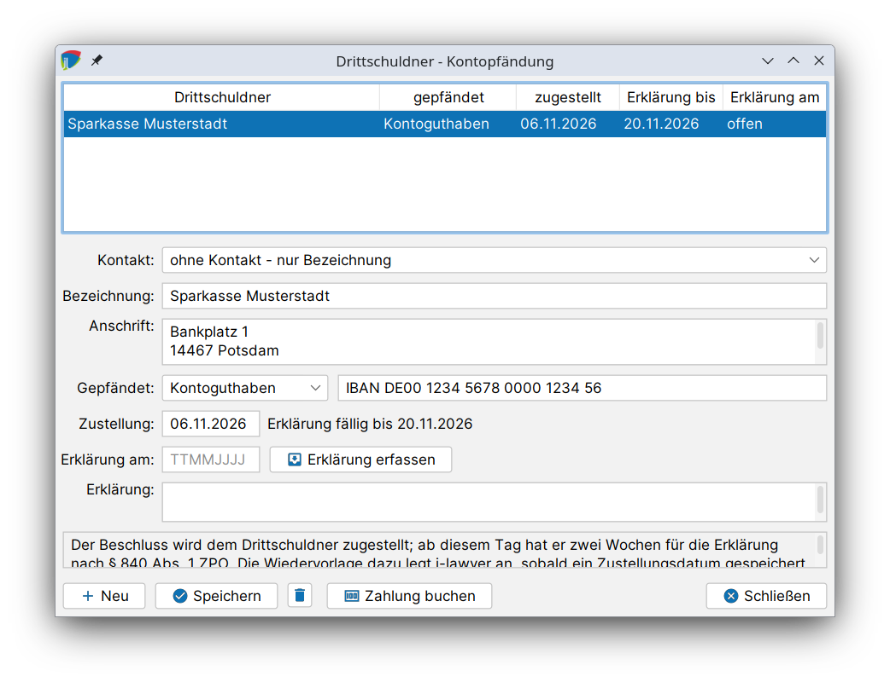

# Zwangsvollstreckung

Liegt ein vollstreckbarer Titel vor und zahlt der Schuldner weiterhin nicht, wird die Forderung zwangsweise beigetrieben. Im Reiter **Zwangsvollstreckung** des Forderungskontos werden die einzelnen **Vollstreckungsmaßnahmen** angelegt und verfolgt: vom Vollstreckungsauftrag an den Gerichtsvollzieher über den Pfändungs- und Überweisungsbeschluss bis zur Auskunft aus dem Schuldnerverzeichnis. j-lawyer.org füllt dabei die **amtlichen Formulare** nach der Zwangsvollstreckungsformular-Verordnung (ZVFV) aus, schlägt die **Kosten** nach § 788 ZPO vor, verwaltet **Drittschuldner** und überwacht die **Fristen**.

!!! abstract "Auf einen Blick"
    - **Voraussetzungen:**
        - Ein vollständiger [Titel](titel.md) mit Klausel und Zustellung (außer bei Maßnahmen ohne Titel wie der Vollstreckungsandrohung)
        - Die [Vollstreckungsformulare](einrichtung.md#vollstreckungsformulare) in der gültigen Fassung
        - Gerichtsvollzieher, Vollstreckungsgerichte und Drittschuldner in den Adressen bzw. [Gerichtsstammdaten](einrichtung.md#gerichte)
    - **Ergebnis:** Ausgefüllte ZVFV-Formulare in der Akte, gebuchte Vollstreckungskosten, Wiedervorlagen zu Sachstand und Drittschuldnererklärung, festgehaltenes Ergebnis.
    - **Prozessleiste:** Station **Vollstreckung**, sobald eine Maßnahme angelegt ist.
    - **Nächster Schritt:** Eingehende Zahlungen [buchen](buchungen.md#zahlungsverteilung), bis die Forderung **erledigt** ist.

## Ablauf im Überblick {#ablauf}

1. [Maßnahme anlegen](#massnahme-anlegen): Titel, Maßnahmeart und Empfänger wählen.
2. [Formulare erzeugen](#formulare): Die amtlichen Formulare werden ausgefüllt und in der Akte abgelegt.
3. Die Formulare an Gerichtsvollzieher oder Vollstreckungsgericht senden, bspw. über das [beA](../addon-bea.md), und das **Absendedatum** in der Maßnahme eintragen.
4. [Kosten](#kosten) der Maßnahme buchen.
5. Bei Pfändungen: [Drittschuldner](#drittschuldner) erfassen und deren Erklärung überwachen.
6. [Ergebnis](#ergebnis) festhalten, sobald die Maßnahme abgeschlossen ist.

## Maßnahme anlegen {#massnahme-anlegen}

1. Forderungskonto öffnen und in den Reiter **Zwangsvollstreckung** wechseln.
2. Auf **Maßnahme** klicken.
3. Im Dialog **Vollstreckungsmaßnahme** die Angaben eintragen und mit **Anlegen** übernehmen.

| Feld | Bedeutung |
|---|---|
| Titel | Der Titel, aus dem vollstreckt wird (§ 750 Abs. 1 ZPO). Für Maßnahmen ohne Titel steht „- ohne Titel -“ zur Verfügung. |
| Maßnahme | Die Maßnahmeart (siehe unten) |
| Datum | Datum der Maßnahme, bspw. des Antrags |
| Absendung | Tag, an dem die Maßnahme hinausgegangen ist. Ab diesem Tag läuft die Wiedervorlage zum Sachstand. Leer lassen, solange die Maßnahme noch nicht versandt ist. |
| Empfänger | Gerichtsvollzieher, Vollstreckungsgericht oder Behörde, mit Bezeichnung und Anschrift, wie sie auf das Formular übernommen werden |
| Notizen | Interne Anmerkungen |

Neben der Absendung zeigt der Dialog, nach wie vielen Tagen die Wiedervorlage zum Sachstand eingetragen wird, bzw. „ohne Absendedatum keine Wiedervorlage zum Sachstand“.

### Nicht mögliche Maßnahmen {#nicht-moeglich}

j-lawyer.org zeigt in der Auswahl alle Maßnahmearten. Maßnahmen, die mit dem gewählten Titel nicht zulässig sind, erscheinen ausgegraut mit dem Zusatz „— nicht möglich“ und dem Grund:

| Grund | Rechtsgrundlage |
|---|---|
| Dafür wird ein Titel benötigt. | § 750 Abs. 1 ZPO |
| Der Titel trägt noch keine Vollstreckungsklausel. | § 724 ZPO |
| Der Titel ist dem Schuldner noch nicht zugestellt. | § 750 Abs. 1 ZPO |
| Die Zustellung des Titels ist auf einen späteren Tag datiert. | |
| Eine Zwangssicherungshypothek ist erst ab 750 Euro zulässig. | § 866 Abs. 3 ZPO |
| Diese Maßnahmeart ist in den Einstellungen abgeschaltet. | |

### Maßnahmearten {#massnahmearten}

| Maßnahme | Empfänger | Amtliche Formulare (ZVFV) | Wiedervorlage nach |
|---|---|---|---|
| Vollstreckungsandrohung (ohne Titel, Schreiben) | sonstiger Empfänger | – | 14 Tagen |
| Vollstreckungsauftrag an den Gerichtsvollzieher (Sachpfändung, gütliche Erledigung, Vermögensauskunft, Haftbefehl, Zustellung) | Gerichtsvollzieher | Anlage 1, Anlage 6 | 42 Tagen |
| Abnahme der Vermögensauskunft (§ 802c ZPO) | Gerichtsvollzieher | Anlage 1, Anlage 6 | 42 Tagen |
| Haftbefehlsantrag (§ 802g ZPO) | Vollstreckungsgericht | Anlage 1, Anlage 6 | 42 Tagen |
| Antrag auf richterliche Durchsuchungsanordnung (§ 758a ZPO) | Vollstreckungsgericht | Anlage 2, Entwurf Anlage 3 | 30 Tagen |
| Pfändungs- und Überweisungsbeschluss (Geldforderung) | Vollstreckungsgericht | Anlage 4, Entwurf Anlage 5, Anlage 7 | 30 Tagen |
| Pfändungs- und Überweisungsbeschluss (Unterhalt) | Vollstreckungsgericht | Anlage 4, Entwurf Anlage 5, Anlage 8 | 30 Tagen |
| Lohnpfändung | Vollstreckungsgericht | Anlage 4, Entwurf Anlage 5, Anlage 7 | 30 Tagen |
| Kontopfändung | Vollstreckungsgericht | Anlage 4, Entwurf Anlage 5, Anlage 7 | 30 Tagen |
| Zwangssicherungshypothek | Grundbuchamt | – | 30 Tagen |
| Antrag auf Zwangsversteigerung | Vollstreckungsgericht | – | 60 Tagen |
| Antrag auf Zwangsverwaltung | Vollstreckungsgericht | – | 60 Tagen |
| Einwohnermeldeamtsanfrage | Register oder Behörde | – | 21 Tagen |
| Auskunft aus dem Schuldnerverzeichnis | Register oder Behörde | – | 21 Tagen |
| Sonstige Auskunft (§ 802l ZPO) | Register oder Behörde | – | 21 Tagen |

Für Maßnahmen ohne amtliches Formular wird ein Schreiben aus einer [Dokumentvorlage](../dokumentenmanagement/vorlagen.md) erstellt, wie für jedes andere Schreiben in der Akte.

## Formulare erzeugen {#formulare}

**Formulare erzeugen** füllt die amtlichen Formulare der ZVFV für die markierte Maßnahme aus und legt sie als PDF in der Akte ab. j-lawyer.org übernimmt dabei unter anderem:

- Gläubiger, Schuldner und gesetzliche Vertreter aus den [Stammdaten](anlegen.md#stammdaten)
- den Bevollmächtigten (Kanzlei und Anwalt)
- die Angaben zum Titel
- Empfänger und Drittschuldner der Maßnahme
- die **Forderungsaufstellung** (Anlagen 6, 7 und 8), gegliedert nach titulierter Hauptforderung, titulierten Kosten, weiteren Forderungen, weiteren Kosten der Zwangsvollstreckung und Zahlungen

Vor dem Erzeugen fragt j-lawyer.org, ob die Formulare **festgeschrieben** werden sollen:

- **Ja:** Die Formularfelder werden fixiert, das Formular ist fertig zum Versand.
- **Nein:** Die Felder bleiben ausfüllbar, bspw. um Angaben zu ergänzen, die das Forderungskonto nicht führt.

Anschließend meldet j-lawyer.org, welche Dokumente in der Akte abgelegt wurden. In der Tabelle zeigt die Spalte **Formularfassung**, mit welcher Fassung der Formulare die Maßnahme erstellt wurde.

!!! warning "Gültige Formularfassung"
    Die ZVFV-Formulare werden von Zeit zu Zeit neu gefasst. j-lawyer.org verwendet die Fassung, die am Datum der Maßnahme gilt. Ist keine passende Fassung hinterlegt, wird die neueste verwendet und darauf hingewiesen, dass das Formular möglicherweise nicht mehr das vorgeschriebene ist. Neue Fassungen werden unter [Einrichtung: Vollstreckungsformulare](einrichtung.md#vollstreckungsformulare) importiert.

## Kosten der Zwangsvollstreckung {#kosten}

Die notwendigen Kosten der Zwangsvollstreckung fallen dem Schuldner zur Last und werden mit der Hauptforderung beigetrieben (§ 788 Abs. 1 ZPO). Mit **Kosten** öffnet sich der Dialog **Kosten der Zwangsvollstreckung** für die markierte Maßnahme.

j-lawyer.org schlägt die Kostenpositionen anhand des Gegenstandswerts vor:

| Position | Rechtsgrundlage |
|---|---|
| 0,3 Verfahrensgebühr | Nr. 3309 VV RVG |
| 0,3 Terminsgebühr (sofern angefallen) | Nr. 3310 VV RVG |
| Pauschale für Post- und Telekommunikationsentgelte | Nr. 7002 VV RVG |
| Umsatzsteuer | Nr. 7008 VV RVG |
| Gerichtsgebühr für den Pfändungs- und Überweisungsbeschluss | Nr. 2111 KV GKG |
| Kosten des Gerichtsvollziehers | Betrag von Hand eintragen |

In der Spalte **ansetzen** wird gewählt, welche Positionen gebucht werden. Die Umsatzsteuer wird nicht angesetzt, wenn der Gläubiger zum Vorsteuerabzug berechtigt ist.

| Feld | Bedeutung |
|---|---|
| Schuldner | „alle gesamtschuldnerisch“ oder ein einzelner Schuldner |
| von der Kanzlei verauslagt | Legt die Kosten zusätzlich als Auslage im Aktenkonto an, bspw. vorgestreckte Gerichtskosten |

Mit **Buchen** werden die gewählten Positionen als Kosten in das Forderungskonto gebucht.

## Drittschuldner {#drittschuldner}

Bei Forderungspfändungen (Pfändungs- und Überweisungsbeschluss, Lohn- und Kontopfändung) zahlt nicht der Schuldner, sondern ein **Drittschuldner**, bspw. der Arbeitgeber oder die Bank. Mit **Drittschuldner** öffnet sich die Verwaltung der Drittschuldner der markierten Maßnahme.

Die Tabelle zeigt **Drittschuldner**, **gepfändet**, **zugestellt**, **Erklärung bis** und **Erklärung am**. Mit **Neu** wird ein weiterer Drittschuldner angelegt, mit **Speichern** werden die Angaben übernommen.

| Feld | Bedeutung |
|---|---|
| Kontakt | Der Drittschuldner aus den Adressen, oder „ohne Kontakt – nur Bezeichnung“ |
| Bezeichnung / Anschrift | Name und Anschrift des Drittschuldners |
| Gepfändet | Was gepfändet ist, bspw. Arbeitseinkommen, Kontoguthaben oder Miete, mit Referenz wie IBAN oder Personalnummer |
| Zustellung | Tag der Zustellung des Beschlusses an den Drittschuldner. Ab diesem Tag läuft die Frist zur Drittschuldnererklärung. |
| Erklärung am / Erklärung | Eingang und Inhalt der Drittschuldnererklärung |

**Erklärung erfassen** hält die Erklärung des Drittschuldners nach § 840 ZPO fest. Der Status zeigt „Erklärung fällig bis …“, „– eingegangen“ oder „– überfällig (§ 840 Abs. 2 S. 2 ZPO)“.

**Zahlung buchen** verbucht eine Zahlung des Drittschuldners im Forderungskonto. Die Zahlung wird nach der [Tilgungsreihenfolge](anlegen.md#tilgungsreihenfolge) des Forderungskontos verteilt.

## Ergebnis festhalten {#ergebnis}

Mit **Ergebnis** wird festgehalten, was aus der Maßnahme geworden ist, mit dem **Datum des Ergebnisses**:

| Ergebnis | Folge |
|---|---|
| offen | Die Maßnahme läuft noch. |
| erfolgreich | Die Maßnahme ist abgeschlossen. |
| teilweise erfolgreich | Die Maßnahme ist abgeschlossen, die Forderung aber nur teilweise beigetrieben. |
| fruchtlos | Hinweis: Damit ist der Weg zur Vermögensauskunft nach § 802c ZPO eröffnet und, wenn der Schuldner sie abgibt oder verweigert, zur Eintragung ins Schuldnerverzeichnis (§ 882c ZPO). |
| zurückgenommen | Die Maßnahme wird nicht weiter verfolgt. |
| einstweilen eingestellt | Die Prozessleiste zeigt „ruht: eine Maßnahme ist einstweilen eingestellt“. |

!!! info "Sperrfrist nach der Vermögensauskunft"
    Ist eine Vermögensauskunft abgeschlossen, gleich mit welchem Ergebnis außer „zurückgenommen“, muss der Schuldner innerhalb von zwei Jahren keine weitere abgeben (§ 802d Abs. 1 ZPO). j-lawyer.org trägt eine Wiedervorlage „Erneute Vermögensauskunft möglich“ zum Ablauf dieser Frist ein, gerechnet ab dem Datum des Ergebnisses. Bis dahin zeigt die Prozessleiste „wartet bis …“.

## Maßnahme ändern oder entfernen {#bearbeiten}

- Der Button zum Bearbeiten ändert Empfänger, Datum, Titel und Anmerkungen der Maßnahme. Wird das Absendedatum geändert, passt j-lawyer.org die Wiedervorlage zum Sachstand an.
- Der Button zum Entfernen löscht die Maßnahme. Die dafür erzeugten Dokumente bleiben in der Akte, denn sie sind möglicherweise bereits bei einem Gericht oder Gerichtsvollzieher eingegangen.
- **Neu laden** aktualisiert die Liste.

## Fristen {#fristen}

j-lawyer.org trägt zu jeder Maßnahme Wiedervorlagen in der Akte ein:

| Wiedervorlage | Berechnung |
|---|---|
| Sachstand der Maßnahme | Absendedatum + Wiedervorlagefrist der Maßnahmeart (siehe Tabelle der Maßnahmearten) |
| Drittschuldnererklärung (§ 840 ZPO) | Zustellung an den Drittschuldner + 2 Wochen (nur als Wiedervorlage und in der Spalte *Erklärung bis* der Drittschuldner) |
| Erneute Vermögensauskunft möglich (§ 802d Abs. 1 ZPO) | Datum des Ergebnisses einer abgeschlossenen Vermögensauskunft + 2 Jahre |

Die Fristen zum Sachstand und zur erneuten Vermögensauskunft sind im Reiter **Fristen & Dokumente** zusammengefasst und erscheinen als „nächste Frist“ in der Prozessleiste. Die Frist zur Drittschuldnererklärung wird beim Drittschuldner und als Wiedervorlage in der Akte geführt. Siehe [Fristen & Wiedervorlagen](fristen.md).
