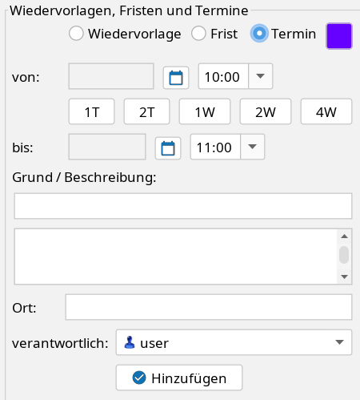

# Aktenbezogener Kalender {#aktenbezogen}

Termine, Wiedervorlagen und Fristen können in separaten Kalendern organisiert werden. Dabei enthält ein Kalender jeweils Einträge eines der drei Ereignistypen. Es kann – bspw. bei Bürogemeinschaften – jeweils mehrere Kalender geben. Sie werden zentral konfiguriert (Menü **Einstellungen** → **Kalender** → **Kalender und Synchronisation konfigurieren**) und in der Nutzerverwaltung (**Einstellungen** → **Nutzer**) für die gewünschten Nutzer freigegeben.

Hat ein Nutzer nur Zugriff auf jeweils einen Kalender für einen Ereignistyp, ist nichts weiter zu beachten. Gibt es für einen Nutzer bspw. mehrere Terminkalender, so kann bei Terminerstellung der gewünschte Zielkalender ausgewählt werden:

Beim Erstellen und Ändern von Kalendereinträgen wird eine Konfliktprüfung ausgeführt.

## Erinnerungen {#erinnerungen}

Für Termine kann eine Erinnerung hinterlegt werden. Beim Anlegen, Bearbeiten oder Duplizieren eines Termins öffnet der Glocken-Button (Tooltip „Erinnerung") ein Menü mit folgenden Vorlaufzeiten:

- Bei Beginn
- 5 Min., 10 Min., 15 Min., 30 Min.
- 1 Std., 2 Std.
- 1 Tag
- Keine Erinnerung

Eine aktive Erinnerung erkennt man am geänderten Glockensymbol.

!!! info "Nur für Termine"
    Erinnerungen stehen ausschließlich für den Typ **Termin** zur Verfügung. Bei Wiedervorlagen und Fristen ist der Glocken-Button deaktiviert.

### Anzeige der Erinnerung

Ist eine Erinnerung fällig, öffnet der Client unten rechts auf dem Bildschirm das Fenster **Terminerinnerungen**. Je Termin werden Betreff, Beginn, ggf. Ort und die Akte angezeigt:

- Ein Klick auf die Akte öffnet diese
- **Bestätigen** blendet die einzelne Erinnerung aus, **Alle bestätigen** schließt das Fenster
- Über **Ort kopieren** wird der Ort in die Zwischenablage übernommen

Das Bestätigen einer Erinnerung markiert den Termin nicht als erledigt.

Erinnert wird der Verantwortliche des Termins. Ist kein Verantwortlicher eingetragen, erhalten alle Nutzer mit Zugriff auf den Kalender die Erinnerung. Voraussetzung ist ein laufender j-lawyer.org Client – der Client prüft einmal pro Minute auf fällige Erinnerungen.

Bei aktiver Synchronisierung mit einem externen Kalender (bspw. Nextcloud) wird die Erinnerung mit übertragen und steht damit auch auf Smartphone oder Tablet zur Verfügung.

Erinnerungen können auch über [Assistent Ingo](../ki-assistent/agenten.md#tools-kalender) gesetzt werden.
